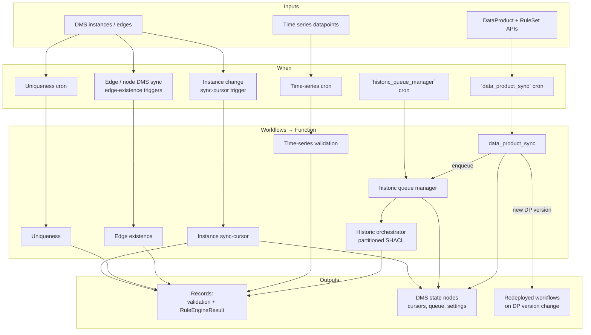

# Data Quality Validation

## Overview

Publishes SHACL **RuleSets** and **DataProducts** with Cognite Toolkit (`cdf deploy`), then boots the validation runtime via the Toolkit-deployed CDF Function
`fn_dataproduct_all_bootstrap_infrastructure`. That function calls the same
[`cognite-data-quality`](https://github.com/cognitedata/data-quality-validation)
`deploy_validation_infrastructure()` path as
[data-quality-validation-deploy](https://github.com/cognitedata/data-quality-validation-deploy)
(stream, record containers/views, validation function, workflows).

By default the module validates the **Cognite Core** (`cdf_cdm`) and **Cognite Process Industries** (`cdf_idm`) views — asset, equipment, time series, maintenance order, operation and notification — with instances in `inst_location`. All customer-specific identifiers (spaces, views, data product, rule set versions) are variables in `default.config.yaml`; see [Configuration](#configuration).

| Layer | Toolkit (`cdf deploy`) | Bootstrap function (`fn_dataproduct_all_bootstrap_infrastructure`) |
| --- | --- | --- |
| RuleSets / DataProducts | Yes | Consumes via `external_dataproducts` |
| Spaces (`dataProductSchemaSpace`, `dataQualitySpace`) | Yes | — |
| Bootstrap Function + Schedule | Yes | Self-deletes schedules after success |
| Record containers + record view (`DataQualityValidationRecord`) | — | Yes (owned and versioned by the Python package) |
| Validation function + orchestration state | — | Yes |
| Instance workflows | — | Yes (external DataProduct + optional `views/` overrides) |
| Time-series workflows | — | Yes (optional `timeseries/` configs) |
| `data_product_sync` + historic queue | — | Yes (`data_product_sync_cron`) |

## Process and data flow

One Toolkit deploy, then continuous validation at runtime. All validation paths invoke the same CDF Function (`data-quality-validation`); workflows differ by **when** they fire and **what** they ask the function to do.

### Deploy → runtime

```mermaid
flowchart LR
  subgraph toolkit["Toolkit (`cdf deploy`)"]
    RS[RuleSets / RuleSetVersions]
    DP[DataProduct versions]
    SP[Spaces]
    BOOT[Bootstrap Function + Schedule]
  end

  subgraph py["Bootstrap → package"]
    FN[CDF Function `data-quality-validation`]
    CTR[DQ record containers + record views]
    WF[Workflows + triggers]
    SET[DataQualitySettings in DMS]
  end

  subgraph cdf["CDF project"]
    INST[Instance spaces]
    REC[Records stream]
    STATE[Orchestration / ViewConfig / HistoricJobQueue]
  end

  RS --> DP
  SP --> DP
  BOOT -->|`deploy_validation_infrastructure()`| FN
  BOOT --> CTR
  BOOT --> WF
  BOOT --> SET
  DP -->|`external_dataproducts`| WF
  FN --> WF
  CTR --> REC
  CTR --> STATE
  SET --> STATE
  INST -->|read| FN
  RS -->|ruleset_references| FN
  FN -->|write| REC
  WF -->|invoke| FN
  WF --> STATE
```

### Runtime validation paths



### Workflows: when they run and what they do

Prefixes and crons below match this module’s `settings.yaml` / sample `views/` and `timeseries_config/` (customize per project).

| Workflow | Trigger / schedule | What it does |
| --- | --- | --- |
| **Instance sync-cursor** (`wf_all_validate_instances-…`) | DMS data-change trigger (batched: `trigger.batch_size` / `batch_timeout`) | Incremental SHACL on changed instances since the last cursor; writes validation records. One consolidated workflow per view (or DataProduct grouping). Does **not** run uniqueness. |
| **Uniqueness** (`…-uniqueness`) | Cron — from SHACL `dqs:schedule`, or view `uniqueness_cron` (sample: Equipment `0 */4 * * *`, MaintenanceOrder `2 * * * *`; default often `0 6 * * *`) | Global uniqueness checks declared in RuleSet (`dqs:uniquenessConstraint` / `dqs:unique`). Created only when SHACL has uniqueness for that view. |
| **Edge existence** (`…-edge-existence`) | Two DMS sync triggers per rule (node + edge), no backfill | Typed-edge cardinality (`dqs:edgeExistenceConstraint`). Deploy-time triggers; baseline over in-scope nodes also runs as part of historic orchestration when rules/DP version change. |
| **Time-series** (`wf_all_validate_timeseries-…`) | Cron from `timeseries_config/*.yaml` (sample: `2 * * * *`) | Datapoint SHACL for filtered series; RuleSets whose `sh:targetClass` matches the timeseries view. |
| **`data_product_sync`** | Cron `data_product_sync_cron` (sample: `13 * * * *`) | Loads managed / external DataProducts; if version or rules changed, redeploys instance/uniqueness/edge/timeseries workflows and may **enqueue historic** jobs for affected views. |
| **Historic queue manager** (`dq-historic-queue-manager`) | Cron ~every 5 minutes (package default) | Drains `HistoricJobQueue` **sequentially** (one orchestration at a time); starts the next job when the current completes or fails; supersedes older queued jobs for the same view when a newer DP version lands. |
| **Historic orchestrator** (function, not a standing WF id) | Started by the queue manager (jobs enqueued by `data_product_sync` on version/rule changes) | Partitioned full-history SHACL for a view; then hands off to sync-cursor + a short-lived **Monitor** function schedule (~every 2 min) until orchestration finishes. |
| **Monitor `{view}` validation** | Function schedule ~every 2 min while historic is `in_progress` / `monitoring` | Retriggers the orchestrator in monitor mode; if the schedule is missing while state is still active, the queue manager marks the job failed (orphaned) so the queue does not block. |

Optional (not in this sample): **`rule_engine_result_sync`** listener workflows — scheduled consumers of `RuleEngineResult` records for rule chaining.

### Data movement (short)

1. **Catalog** — Toolkit publishes RuleSets and DataProduct versions (views + `instanceSpaces` + `quality.rules`), plus the bootstrap Function and Schedule.
2. **Wire-up** — Bootstrap runs `deploy_validation_infrastructure()`: creates the validation Function, state containers in `config_space` (`inst_data_quality`), workflows/triggers from `external_dataproducts` + optional bundled `views/` / `timeseries/` overrides, and persists `DataQualitySettings` / `ViewConfigState`. On success it deletes its own Function Schedules.
3. **Steady state** — Change triggers and crons invoke the Function; it reads instances (or datapoints) and RuleSets, writes **Records** to `records.space` / `records.stream_id`, and updates cursors / orchestration state in DMS.
4. **Version bump** — `data_product_sync` detects a new DataProduct/RuleSet version → redeploys workflows → enqueues historic → queue manager runs full revalidation, then incremental sync resumes.

### Where quality-job results are stored (records)

Validation outputs are **Records** (not DMS instances). This module does **not** ship Toolkit `*.Container.yaml` or `*.View.yaml` for those schemas — the [`cognite-data-quality`](https://github.com/cognitedata/data-quality-validation) package owns and versions them. Review property descriptions, `usedFor: record` (no constraints/indexes), and direct-relation shapes in the package (`cognite_data_quality/_records.py`), not under `data_modeling/`.

| What | Where it is defined / applied |
| --- | --- |
| Result container schemas | Package (`cognite_data_quality/_records.py`), applied by `deploy_validation_infrastructure()` via the bootstrap function |
| Validation results | Container `DataQualityValidationRecord` (`usedFor: record`) in `records.space` |
| SHACL-AF / rule-engine inferences | Container `RuleEngineResult` (`usedFor: record`) in the same space |
| Record view | Same package — `DataQualityValidationRecord` with `streamId` bound to `records.stream_id`. Do not add a Toolkit copy under `data_modeling/views/`. |
| Orchestration / runtime state | Package-created DMS containers in `config_space` (`dataQualitySpace`) |
| Stream + space target | Bundled / overridden settings → `records.space` / `records.stream_id` (variables `dataQualitySpace` / `recordsStreamId`) |

**How to use the record view**

- **Do** read/write through the [Records API](https://docs.cognite.com/cdf/dm/records/concepts/records_and_streams#record-views) (filter / sync / aggregate / upsert / list / retrieve), optionally with the view as `source`, or via Flows / clients that call those endpoints. The view binds `streamId` so consumers need not hard-code the stream.
- **Do not** add the view to a `*.DataModel.yaml` — [data models cannot include record views yet](https://docs.cognite.com/cdf/dm/records/concepts/records_and_streams#record-views). Records are not returned by `/models/instances/query` or GraphQL.
- **Do not** expect CDF Transformations (Spark SQL) to read or write this view — Transformations have no records/stream destination; use the Records API, a Function, or (for stream pipelines) Hosted Extractors.

Field reference: [Records output](https://cognite-data-quality-validation.readthedocs-hosted.com/en/latest/usage/records_output.html). Deploy order: `cdf deploy` (RuleSets, DataProducts, spaces, bootstrap Function + Schedule) → bootstrap schedule runs (stream, record containers, record views, validation function, workflows) → bootstrap deletes its schedules on success. A single Toolkit deploy is enough; do not re-run `cdf deploy` for a record view.

See also: [Deploy infrastructure](https://cognite-data-quality-validation.readthedocs-hosted.com/en/latest/usage/deploy.html), [Lifecycle and CI/CD](https://cognite-data-quality-validation.readthedocs-hosted.com/en/latest/usage/lifecycle.html).

## Prerequisites

Requires Cognite Toolkit version **> 0.9** for Records support (`streamId` on views and streams used by validation results; the `record-views` alpha flag is no longer required).

RuleSets and DataProducts require the Toolkit [`data-products` alpha flag](https://docs.cognite.com/cdf/deploy/cdf_toolkit/api/alpha_flags#alpha-flag-data-products) (Toolkit `0.7.207+`). Enable it in `cdf.toml` before `cdf build`:

```toml
[alpha_flags]
data-products = true
```

The `[alpha_flags]` header must be uncommented. If only `data-products = true` is set (for example under `[plugins]`), Toolkit ignores it: `cdf build` emits only the spaces under `data_modeling/` and skips `rulesets/` / `data_products/`. Then bootstrap fails with `Data product version 'data_quality_core:1.0.0' not found` (404).

After enabling the flag, run `cdf build && cdf deploy` so the data product version exists in CDF before (or in the same deploy as) the bootstrap Function. The five-minute bootstrap schedule retries until the catalog is present.

The instance space (`instanceSpace`, default `inst_location`) must already exist and contain the nodes to validate; this module does not create it. The records stream (`recordsStreamId`, default `cdf_all_validation_results`) is created by bootstrap if missing (immutable `BasicArchive` template).

### Access control

The identity used by `cdf deploy` (Toolkit `.env` / `IDP_*` service principal or user) needs these capabilities on the CDF project. For DataProducts and RuleSets, actions are `CREATE`, `READ`, `UPDATE`, and `DELETE` (there is no `WRITE`):

| Capability | Needed for |
| --- | --- |
| `dataProductsAcl:CREATE` / `UPDATE` / `DELETE` | Create/update/delete DataProducts via `cdf deploy` |
| `dataProductsAcl:READ` | Bootstrap loading external DataProducts (for example `data_quality_core`) when deploying workflows |
| `ruleSetsAcl:CREATE` / `READ` / `UPDATE` / `DELETE` | Create/update/delete RuleSets and RuleSetVersions via `cdf deploy` |
| `streamsAcl:READ` / `CREATE` / `DELETE` | Installation: bootstrap ensuring `recordsStreamId` exists (creates with `BasicArchive` if missing); delete when cleaning up |
| `functionsAcl:READ` / `WRITE` | Deploy the bootstrap Function / Schedule; bootstrap identity resolving the function and deleting its Function Schedule after a successful run |

Grant these (typically all actions, scope `all`) in Fusion → Access management on the group linked to that identity — for Toolkit this is often `cognite_toolkit_service_principal`.

The identity used **at runtime** by the CDF Functions (the service principal whose `client-id` / `client-secret` were registered via Toolkit `functionClientId` / `functionClientSecret`) must also have Streams access and stream records **READ** / **WRITE** on the configured records stream (`recordsStreamId`, default `cdf_all_validation_results`). Without these, validation fails when posting results. The same identity needs `functionsAcl:READ` / `WRITE` so the bootstrap function can resolve itself and delete its schedule after success:

| Capability | Needed for |
| --- | --- |
| `streamsAcl:READ` | Resolve stream type for `recordsStreamId` |
| `streamRecordsAcl:READ` / `WRITE` | Read/write validation result records (scope `all`, or at least `dataQualitySpace`) |
| `functionsAcl:READ` / `WRITE` | Bootstrap self-delete of Function Schedules for `fn_dataproduct_all_bootstrap_infrastructure` |

```text
WARNING: could not resolve stream type for 'cdf_all_validation_results'; defaulting to immutable (ingest):
The user does not have the required Streams capabilities. | code: 403
ERROR posting record for …: The user does not have stream records read or write capability. | code: 403
```

Grant Streams access and stream records **READ** / **WRITE** (scope `all`, or at least the records stream and `dataQualitySpace`) on the group linked to that function identity.

Common deploy-time errors:

```text
CogniteAPIError: Missing capability DataProducts:READ | code: 403
CogniteAPIError: Missing capability RuleSets:CREATE | code: 403
Data product version 'data_quality_core:1.0.0' not found | code: 404
```

The 404 means Toolkit has not deployed that DataProduct version yet (alpha flag off, or `cdf deploy` not run / failed). Leave the bootstrap schedule in place — it retries every five minutes — or fix the catalog and re-run `cdf deploy`.

`cdf deploy` creates two spaces from `data_modeling/`: `dataProductSchemaSpace` (owned by the data product) and `dataQualitySpace` (runtime state and records).

## Configuration

Customer-specific identifiers live in [`default.config.yaml`](default.config.yaml). Override them in your Toolkit `config.<env>.yaml`:

```yaml
variables:
  modules:
    common:
      cdf_dq_runtime:
        schemaSpace: cdf_cdm
        secondarySchemaSpace: cdf_idm
        instanceSpace: inst_location
        # ... any other key from default.config.yaml
```

`cdf build` substitutes them into `rulesets/`, `data_products/` and `data_modeling/`. Toolkit also substitutes the same module variables into the bootstrap Function secrets and Schedule `data` (spaces, stream, dataset, data product, view identifiers, `instanceSpace`, `ruleSetVersion`, `timeSeriesExternalIdPrefix`, plus `functionClientId` / `functionClientSecret`). The bootstrap handler validates Schedule `data` with Pydantic, merges settings overrides into the bundled `config/settings.yaml`, and substitutes placeholders in bundled `config/views/` and `config/timeseries_config/` at runtime (Toolkit cannot substitute placeholders inside the function code bundle).

| Variable | Default | Used in | Meaning |
| --- | --- | --- | --- |
| `schemaSpace` | `cdf_cdm` | rulesets, data product, views, timeseries_config | Schema space of the asset, equipment and time series views |
| `secondarySchemaSpace` | `cdf_idm` | rulesets, data product, views | Schema space of the maintenance order, operation and notification views. Set equal to `schemaSpace` when all views live in one enterprise space |
| `viewVersion` | `v1` | data product, views, timeseries_config | Version of every validated view |
| `viewAssetExternalId` | `CogniteAsset` | rulesets, data product, views | Asset view (in `schemaSpace`) |
| `viewEquipmentExternalId` | `CogniteEquipment` | rulesets, data product, views | Equipment view (in `schemaSpace`) |
| `viewTimeSeriesExternalId` | `CogniteTimeSeries` | rulesets, data product, timeseries_config | Time series view (in `schemaSpace`) |
| `viewMaintenanceOrderExternalId` | `CogniteMaintenanceOrder` | rulesets, data product, views | Maintenance order view (in `secondarySchemaSpace`) |
| `viewOperationExternalId` | `CogniteOperation` | rulesets, data product, views | Operation view (in `secondarySchemaSpace`) |
| `viewNotificationExternalId` | `CogniteNotification` | rulesets, data product, views | Notification view (in `secondarySchemaSpace`) |
| `instanceSpace` | `inst_location` | rulesets, data product, views, timeseries_config | Instance space with the nodes to validate (all views). Must already exist |
| `timeSeriesExternalIdPrefix` | `pi:` | timeseries_config | External ID prefix selecting time series for datapoint validation |
| `dataProductSchemaSpace` | `dm_sol_data_quality` | data product, data_modeling | Schema space owned exclusively by the data product. Must not be a `cdf_*` space or owned by another data product |
| `dataProductExternalId` | `data_quality_core` | data product, settings / Schedule.data | Data product binding views, instance spaces and rule sets |
| `dataProductVersion` | `1.0.0` | data product, settings / Schedule.data | Data product version. Bump when views, instance spaces or rule set versions change (they are immutable on an existing version) |
| `ruleSetVersion` | `1.0.0` | rulesets, data product, timeseries_config | Version of every RuleSetVersion. Bump when you edit rule content |
| `dataQualitySpace` | `inst_data_quality` | settings / Schedule.data, data_modeling | Space for runtime state (settings, cursors, historic queue) and record containers |
| `recordsStreamId` | `cdf_all_validation_results` | settings / Schedule.data | Records stream for validation results. Created by bootstrap if missing |
| `functionCodeDatasetExternalId` | `ds_data_quality_all` | settings / Schedule.data | Data set for the CDF Function code file |
| `functionClientId` | `${IDP_CLIENT_ID}` | schedule + function secrets | Client ID for the bootstrap Function Schedule and Function secrets (`client-id`) used as workflow trigger credentials |
| `functionClientSecret` | `${IDP_CLIENT_SECRET}` | schedule + function secrets | Client secret for the bootstrap Function Schedule and Function secrets (`client-secret`) |
| `functionOwner` | `cdf_dq_runtime` | Function YAML | Owner shown on the bootstrap Function in Fusion |

A data product version may only reference views in its own schema space or in a `cdf_*` system space. To validate your own enterprise views, set `dataProductSchemaSpace`, `schemaSpace` and `secondarySchemaSpace` to the enterprise schema space (when no other data product owns it).

### Runtime settings (`settings.yaml`)

[`settings.yaml`](settings.yaml) documents the runtime behaviour of the data quality service (and is the template for the bundled copy under `functions/fn_dataproduct_all_bootstrap_infrastructure/config/`). Every key is documented inline:

| Key | Meaning |
| --- | --- |
| `workflow.external_id_prefix` / `version` | Prefix and version of instance validation workflows (`<prefix>-<data product>[-uniqueness\|-edge-existence]`) |
| `workflow.task.retries` / `timeout` / `on_failure` | Retries, timeout (seconds) and failure policy (`abortWorkflow` or `skipTask`) of the validation function task |
| `timeseries_workflow.*` | Same settings for time series workflows; task timeout capped at 900 s (CDF Function limit) |
| `trigger.external_id_prefix` | Prefix of DMS data-change triggers |
| `trigger.batch_size` / `batch_timeout` | Changed instances per run, and seconds to wait for a full batch |
| `records.space` / `records.stream_id` | Target space and stream for validation records |
| `config_space` | Space for `DataQualitySettings`, cursors, orchestration state and `HistoricJobQueue` |
| `function_code_dataset_external_id` | Data set for the Function code file |
| `config_source` | `dataproduct`: read views, instance spaces and rules from the data products in `external_dataproducts` |
| `data_product_sync_cron` | Cron (UTC) for `data_product_sync`, which redeploys workflows and enqueues historic revalidation on version changes |
| `timeseries.config_dir` | Folder with time series validation configs (`timeseries_config`) |
| `external_dataproducts` | Data products published by Toolkit; wired without republishing |

Per-view tuning (partitioning, batch sizes, `max_concurrent_executions: 1`, `uniqueness_cron`) is in `views/*.yaml`; time series schedule and filter in `timeseries_config/timeseries_quality.yaml`. Matching copies ship under the bootstrap Function’s `config/views/` and `config/timeseries_config/` (not `config/timeseries/`, which Toolkit would treat as TimeSeries resources) so bootstrap applies them. Toolkit cannot substitute placeholders inside the function zip — Schedule.`data` carries the module variables and the handler substitutes them at runtime before calling `deploy_validation_infrastructure()`.

### SHACL rules and view IRIs

The sample rules in `rulesets/` address views as `http://purl.org/cognite/<space>/<view>/` (class `<namespace><view>`, properties `<namespace><property>`) and instances as `http://purl.org/cognite/<instanceSpace>/<externalId>`. These IRIs are built from the variables above, so the rules follow your configured views. Shape logic (allowed status values, order type patterns, value bounds) is sample content: review it against your data. Time-series rules target the configured view class only (no hard-coded series external IDs). The defaults are verified against Cognite Core and Process Industries view definitions; priority ranges start at `0` because Cognite uses `0` for the highest priority.

## Operator flow

### Bootstrap flow

`cdf deploy` publishes `fn_dataproduct_all_bootstrap_infrastructure` and a five-minute
Function Schedule. Toolkit variables (`dataQualitySpace`, `recordsStreamId`,
and related keys) are passed on `Schedule.data` because they are not
substituted inside the function code bundle; the handler merges them into
`settings.yaml` before calling the package deploy entrypoint (idempotent).
The Function also receives `client-id` / `client-secret` secrets (from
`functionClientId` / `functionClientSecret`); the handler maps those into
`settings.runtime_credentials` and overlays them onto the in-function
Cognite client so workflow triggers (external DataProduct instance workflows
and `dq-data-product-sync`) can be upserted. Schedule authentication alone
exposes a token, not `client_id`/`client_secret`, and
`cognite-data-quality` 0.5.x does not forward Function secrets into the
external DataProduct workflow deploy path.
After a **successful** deploy, the function resolves
`fn_dataproduct_all_bootstrap_infrastructure` by external id and deletes every
Function Schedule for that numeric `functionId` (Toolkit authenticated schedules
are stored under `functionId`, not `functionExternalId`). Delete failures are
printed to the function log (`CogniteAPIError` includes the HTTP code) and do not
fail the deploy result. If bootstrap fails, the five-minute schedule stays so the
next cron tick can retry. A later `cdf deploy` recreates the schedule when needed.
The schedule identity needs `functionsAcl:READ` / `WRITE` to look up the function
and delete schedules (403 in the logs means grant those actions). Stuck schedules
can also be removed in Fusion or via `manage_rulesets.ipynb`. Data Quality record
views remain owned by the package.

### Local

```bash
cdf modules add dp:data_quality
# Ensure data-products = true under [alpha_flags] in cdf.toml (see Prerequisites)
cdf build && cdf deploy
# Wait for the bootstrap Function Schedule (~every 5 minutes) to wire
# stream, record containers/views, validation function, and workflows.
# On success the schedule is deleted; on failure it retries.
```

Credentials for Toolkit and the notebooks come from the Toolkit project ``.env`` (next to ``cdf.toml``):
``CDF_*`` / ``IDP_*`` (same family as [data-quality-validation-deploy](https://github.com/cognitedata/data-quality-validation-deploy)).

Historic revalidation is enqueued automatically by `data_product_sync` when a DataProduct or RuleSet version changes. Use [`scripts/manage_rulesets.ipynb`](scripts/manage_rulesets.ipynb) to inspect or clear stuck historic queue jobs and Monitor schedules.

### Managing rule sets

Rule sets cannot be updated in place, and CDF refuses to delete a rule set that still has versions. If you change a `*.RuleSet.yaml` (for example its `name`) after it was deployed, `cdf deploy` fails with:

```text
ResourceDeleteError: Failed to delete rule sets due to API error: Request failed with status code 400:
Rule set 'asset_shacl_rules' can not be deleted, because it contains versions
```

`cdf clean` does not fix this when CDF holds older versions than `rulesets/` defines (for example `1.0.0` in CDF, `2.0.0` locally), because it deletes only the versions in the build.

Use [`scripts/manage_rulesets.ipynb`](scripts/manage_rulesets.ipynb) instead. It uses the same `.env` credentials as Toolkit and provides:

| Function | What it does |
| --- | --- |
| `list_rulesets()` | Prints every rule set in the project with its name and versions |
| `list_ruleset_versions(external_id)` | Returns the versions of one rule set |
| `list_data_products()` | Prints every data product with its versions and the rule set versions each one references |
| `delete_rulesets(external_ids, dry_run=True)` | Deletes the data product versions that reference the rule sets, then all versions of each rule set, then the rule set |
| `delete_data_products(external_ids, dry_run=True)` | Deletes all versions of each data product, then the data product (for example an old data product left empty) |
| `list_monitor_schedules()` | Prints function schedules whose name starts with `Monitor ` (historic orchestration monitors) |
| `delete_monitor_schedules(schedule_ids, dry_run=True)` | Deletes selected monitor schedules by id (for example a stuck `Monitor YourOrgAsset validation` schedule after switching views) |
| `list_historic_queue_jobs()` | Prints `HistoricJobQueue` nodes in `dataQualitySpace` (status, view, data product, orchestration id) |
| `delete_historic_queue_jobs(external_ids, dry_run=True)` | Deletes selected queue jobs and linked `OrchestrationState` / matching Monitor schedules (use for stuck `hq_YourOrg*` jobs left after a view switch) |
| `list_dq_workflows()` | Prints DQ workflows (`wf_all_validate_instances-*`, `wf_all_validate_timeseries-*`, plus shared `dq-data-product-sync`, `dq-historic-queue-manager`, `dq-stream-retention-guard`) and their triggers |
| `delete_dq_workflows(external_ids, dry_run=True)` | Deletes selected workflows after removing every trigger that targets them (use for stale `YourOrg*` / previous data-product workflows, or shared `dq-*` workflows when tearing down the runtime) |
| `list_dq_functions()` | Prints DQ CDF Functions present in the project (`data-quality-validation`, `fn_dataproduct_all_bootstrap_infrastructure`) with schedule counts |
| `delete_dq_functions(external_ids, dry_run=True)` | Deletes selected functions after removing every schedule that targets them (use when tearing down or re-bootstrapping the runtime) |

CDF refuses to delete a rule set version that a data product version still references (`Version '1.0.0' of rule set '...' can not be deleted, because it is referenced by 1 data product version(s)`), which is why `delete_rulesets` removes those data product versions first. All delete functions only print what they would delete unless `dry_run=False`.

The notebook lists rule sets, data products, stuck `Monitor …` function schedules, historic queue jobs, DQ validation workflows, and DQ functions as selection lists (requires `ipywidgets`: `pip install ipywidgets`). Select what to delete, click **Delete selected** with **Dry run** checked to review, uncheck **Dry run** and click again; the lists then refresh from CDF. Afterwards run `cdf deploy` to recreate the rule sets and this module's data product version. Bootstrap recreates validation workflows on the next successful run (re-deploy to restore the five-minute schedule if it was already deleted). Deleting shared `dq-*` workflows or DQ functions tears down the runtime — recreate with `cdf deploy` so bootstrap runs again.

### Inspecting validation content

Use [`scripts/inspect_dq_content.ipynb`](scripts/inspect_dq_content.ipynb) for a read-only inventory of module content in CDF (same `.env` credentials):

| Function | What it does |
| --- | --- |
| `get_stream()` / `aggregate_records()` | Stream metadata and counts for `recordsStreamId` (default last 7 days) |
| `list_validation_records(...)` | Lists top 20 validation rows from the records stream via the Records API (container `DataQualityValidationRecord`; optional `passed_validation` / `rule_set_id` filters; raise `max_records` or use `None` for the full window) |
| `list_rule_engine_results(...)` | Lists `RuleEngineResult` inference rows from the same stream |
| `list_rulesets()` / `list_data_products()` | Catalog resources published by Toolkit |
| `list_dq_function()` / `list_dq_workflows()` / `list_monitor_schedules()` | Runtime function, workflows/triggers, and Monitor schedules |
| `list_recent_function_calls()` | Recent `data-quality-validation` calls with mode (`validation_type`) and posted-record counts from logs |
| `inspect_function_modes()` | Groups recent function logs by mode; reports execution problems, or `mode <name> running without error`. Set `DUMP_FULL_LOGS = True` (or call `dump_function_call_log(call_id=…)`) to print full problem logs |
| `list_module_spaces()` / `list_data_quality_schema()` / `list_historic_queue_jobs()` | Spaces, containers/views in `dataQualitySpace`, and historic queue nodes |

Immutable streams require a `lastUpdatedTime` window on every filter/aggregate call; the notebook defaults to 7 days.

### CI/CD

Run `cdf build && cdf deploy` in GitHub Actions with the Toolkit environment block (`IDP_*`, `CDF_*`). Bootstrap is part of that deploy — no separate Python install step. See [Toolkit pack CI/CD](https://github.com/cognitedata/data-quality-validation/blob/main/docs/usage/toolkit_pack.md#cicd).

## Module Structure

```text
cdf_dq_runtime/
├── default.config.yaml        # Customer identifiers (variables), see Configuration
├── settings.yaml              # Runtime settings template (bundled under the bootstrap function)
├── module.toml
├── data_modeling/             # Toolkit: spaces only (record containers/views owned by the package)
├── data_products/             # Toolkit: DataProduct + DataProductVersion (views, instance spaces, rules)
├── rulesets/                  # Toolkit: RuleSet + RuleSetVersion (SHACL) per view
├── views/                     # Optional per-view workflow overrides (bundle under function config/views when needed)
├── timeseries_config/         # Optional time series validation config (bundle under function config/timeseries_config when needed)
├── functions/                 # Toolkit: bootstrap Function + Schedule + bundled config/
└── scripts/                   # _cli.py (notebook helpers), manage_rulesets.ipynb, inspect_dq_content.ipynb
```

**RuleSets:** `asset_shacl_rules`, `equipment_shacl_rules`, `maintenance_order_shacl_rules`, `notification_shacl_rules`, `operation_shacl_rules`, `timeseries_quality_rules` (adapted from the cog-ai sample in data-quality-validation-deploy).

## Support

- [data-quality-validation](https://github.com/cognitedata/data-quality-validation)
- [data-quality-validation-deploy (cog-ai)](https://github.com/cognitedata/data-quality-validation-deploy/tree/main/config/environments/cog-ai)
