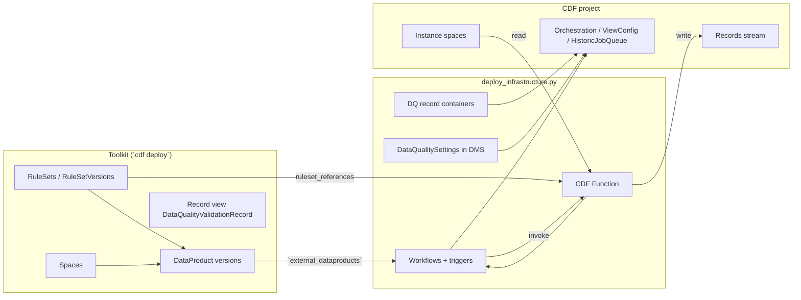
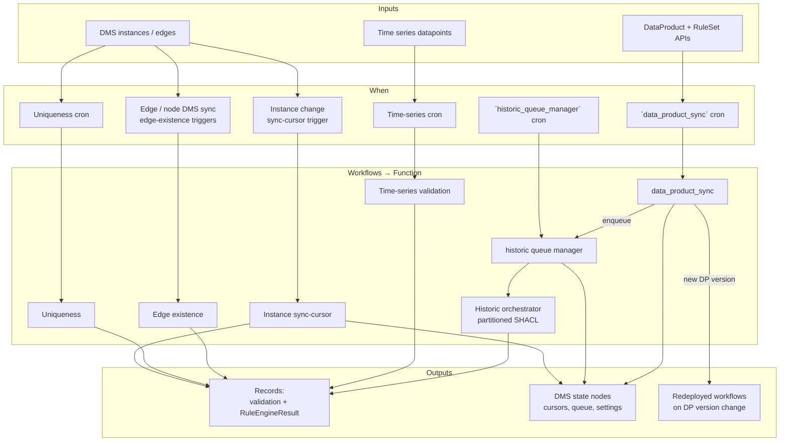

# Data Quality Validation

## Overview

Publishes SHACL **RuleSets** and **DataProducts** with Cognite Toolkit (`cdf deploy`), then runs the same Python deploy path as [data-quality-validation-deploy](https://github.com/cognitedata/data-quality-validation-deploy) (`scripts/deploy_infrastructure.py`).

By default the module validates the **Cognite Core** (`cdf_cdm`) and **Cognite Process Industries** (`cdf_idm`) views — asset, equipment, time series, maintenance order, operation and notification — with instances in `inst_location`. All customer-specific identifiers (spaces, views, data product, rule set versions) are variables in `default.config.yaml`; see [Configuration](#configuration).

| Layer | Toolkit (`cdf deploy`) | Module script (`deploy_infrastructure.py`) |
| --- | --- | --- |
| RuleSets / DataProducts | Yes | Consumes via `external_dataproducts` |
| Record view (`DataQualityValidationRecord`) | Yes (`data_modeling/views/` — `streamId` only) | — (`usedFor: record` is on the container from Python deploy) |
| Function + record containers | — | Yes |
| Instance workflows | — | Yes (external DataProduct + `views/` overrides) |
| Time-series workflows | — | Yes (`timeseries_config/` configs) |
| `data_product_sync` + historic queue | — | Yes (`data_product_sync_cron`) |

## Process and data flow

Two deploy stages, then continuous validation at runtime. All validation paths invoke the same CDF Function (`cognite-data-quality`); workflows differ by **when** they fire and **what** they ask the function to do.

### Deploy → runtime



### Runtime validation paths



### Workflows: when they run and what they do

Prefixes and crons below match this module’s `settings.yaml` / sample `views/` and `timeseries_config/` (customize per project).

| Workflow | Trigger / schedule | What it does |
| --- | --- | --- |
| **Instance sync-cursor** (`dq-shacl-…`) | DMS data-change trigger (batched: `trigger.batch_size` / `batch_timeout`) | Incremental SHACL on changed instances since the last cursor; writes validation records. One consolidated workflow per view (or DataProduct grouping). Does **not** run uniqueness. |
| **Uniqueness** (`…-uniqueness`) | Cron — from SHACL `dqs:schedule`, or view `uniqueness_cron` (sample: Equipment `0 */4 * * *`, MaintenanceOrder `2 * * * *`; default often `0 6 * * *`) | Global uniqueness checks declared in RuleSet (`dqs:uniquenessConstraint` / `dqs:unique`). Created only when SHACL has uniqueness for that view. |
| **Edge existence** (`…-edge-existence`) | Two DMS sync triggers per rule (node + edge), no backfill | Typed-edge cardinality (`dqs:edgeExistenceConstraint`). Deploy-time triggers; baseline over in-scope nodes also runs as part of historic orchestration when rules/DP version change. |
| **Time-series** (`dq-ts-shacl-…`) | Cron from `timeseries_config/*.yaml` (sample: `2 * * * *`) | Datapoint SHACL for filtered series; RuleSets whose `sh:targetClass` matches the timeseries view. |
| **`data_product_sync`** | Cron `data_product_sync_cron` (sample: `13 * * * *`) | Loads managed / external DataProducts; if version or rules changed, redeploys instance/uniqueness/edge/timeseries workflows and may **enqueue historic** jobs for affected views. |
| **Historic queue manager** (`dq-historic-queue-manager`) | Cron ~every 5 minutes (package default) | Drains `HistoricJobQueue` **sequentially** (one orchestration at a time); starts the next job when the current completes or fails; supersedes older queued jobs for the same view when a newer DP version lands. |
| **Historic orchestrator** (function, not a standing WF id) | Started by queue manager or `deploy_pipeline.py` / `--enqueue-historic` | Partitioned full-history SHACL for a view; then hands off to sync-cursor + a short-lived **Monitor** function schedule (~every 2 min) until orchestration finishes. |
| **Monitor `{view}` validation** | Function schedule ~every 2 min while historic is `in_progress` / `monitoring` | Retriggers the orchestrator in monitor mode; if the schedule is missing while state is still active, the queue manager marks the job failed (orphaned) so the queue does not block. |

Optional (not in this sample): **`rule_engine_result_sync`** listener workflows — scheduled consumers of `RuleEngineResult` records for rule chaining.

### Data movement (short)

1. **Catalog** — Toolkit publishes RuleSets and DataProduct versions (views + `instanceSpaces` + `quality.rules`).
2. **Wire-up** — Python deploy creates the Function, state containers in `config_space` (`dataQuality`), workflows/triggers from `external_dataproducts` + optional `views/` / `timeseries_config/` overrides, and persists `DataQualitySettings` / `ViewConfigState`.
3. **Steady state** — Change triggers and crons invoke the Function; it reads instances (or datapoints) and RuleSets, writes **Records** to `records.space` / `records.stream_id`, and updates cursors / orchestration state in DMS.
4. **Version bump** — `data_product_sync` detects a new DataProduct/RuleSet version → redeploys workflows → enqueues historic → queue manager runs full revalidation, then incremental sync resumes.

### Where quality-job results are stored (records)

Validation outputs are **Records** (not DMS instances). This module does **not** ship Toolkit `*.Container.yaml` for those schemas.

| What | Where it is defined / applied |
| --- | --- |
| Result container schemas | [`cognite-data-quality`](https://github.com/cognitedata/data-quality-validation) package (`cognite_data_quality/_records.py`), applied by `deploy_validation_infrastructure()` / `deploy_infrastructure.py` |
| Validation results | Container `DataQualityValidationRecord` (`usedFor: record`) in `records.space` |
| SHACL-AF / rule-engine inferences | Container `RuleEngineResult` (`usedFor: record`) in the same space |
| Record view | Toolkit `data_modeling/views/DataQualityValidationRecord.View.yaml` — same external ID, version `v1`, `streamId: [recordsStreamId]`. Maps the validation container; CDF **computes** `usedFor: record` on the view from `streamId` (do not set `usedFor` on the view YAML). |
| Stream + space target | This module’s `settings.yaml` → `records.space` / `records.stream_id` (variables `dataQualitySpace` / `recordsStreamId`, defaults `dataQuality` / `test_stream_1`) |

**How to use the record view**

- **Do** read/write through the [Records API](https://docs.cognite.com/cdf/dm/records/concepts/records_and_streams#record-views) (filter / sync / aggregate / upsert / list / retrieve), optionally with the view as `source`, or via Flows / clients that call those endpoints. The view binds `streamId` so consumers need not hard-code the stream.
- **Do not** add the view to a `*.DataModel.yaml` — [data models cannot include record views yet](https://docs.cognite.com/cdf/dm/records/concepts/records_and_streams#record-views). Records are not returned by `/models/instances/query` or GraphQL.
- **Do not** expect CDF Transformations (Spark SQL) to read or write this view — Transformations have no records/stream destination; use the Records API, a Function, or (for stream pipelines) Hosted Extractors.

Field reference: [Records output](https://cognite-data-quality-validation.readthedocs-hosted.com/en/latest/usage/records_output.html). `deploy_infrastructure.py` creates the stream if it does not exist (`BasicArchive`) and ensures the record containers. **On a fresh project, deploying the Toolkit record view before the stream and container exist can fail.** Deploy order: `cdf deploy` → `deploy_infrastructure.py` (creates stream + containers) → re-run `cdf deploy` so the record view succeeds.

See also: [Deploy infrastructure](https://cognite-data-quality-validation.readthedocs-hosted.com/en/latest/usage/deploy.html), [Lifecycle and CI/CD](https://cognite-data-quality-validation.readthedocs-hosted.com/en/latest/usage/lifecycle.html).

## Prerequisites

Requires Cognite Toolkit version **> 0.9** for Records support (`streamId` on views and streams used by validation results; the `record-views` alpha flag is no longer required).

RuleSets and DataProducts require the Toolkit [`data-products` alpha flag](https://docs.cognite.com/cdf/deploy/cdf_toolkit/api/alpha_flags#alpha-flag-data-products) (Toolkit `0.7.207+`). Enable it in `cdf.toml` before `cdf build`:

```toml
[alpha_flags]
data-products = true
```

The `[alpha_flags]` header must be uncommented. If only `data-products = true` is set (for example under `[plugins]`), Toolkit ignores it: `cdf build` emits only the spaces under `data_modeling/` and skips `rulesets/` / `data_products/`. Then `deploy_infrastructure.py` fails with `Data product version 'cognite-core-data-quality:1.0.0' not found` (404).

After enabling the flag, run `cdf build && cdf deploy` so the data product version exists in CDF before the Python script.

The instance space (`instanceSpace`, default `inst_location`) must already exist and contain the nodes to validate; this module does not create it. The records stream (`recordsStreamId`, default `test_stream_1`) is created by `deploy_infrastructure.py` if missing (immutable `BasicArchive` template).

### Access control

The identity used by `cdf deploy` and `deploy_infrastructure.py` (Toolkit `.env` / `IDP_*` service principal or user) needs these capabilities on the CDF project. For DataProducts and RuleSets, actions are `CREATE`, `READ`, `UPDATE`, and `DELETE` (there is no `WRITE`):

| Capability | Needed for |
| --- | --- |
| `dataProductsAcl:CREATE` / `UPDATE` / `DELETE` | Create/update/delete DataProducts via `cdf deploy` |
| `dataProductsAcl:READ` | `deploy_infrastructure.py` loading external DataProducts (for example `cognite-core-data-quality`) when deploying workflows |
| `ruleSetsAcl:CREATE` / `READ` / `UPDATE` / `DELETE` | Create/update/delete RuleSets and RuleSetVersions via `cdf deploy` |
| `streamsAcl:READ` / `CREATE` / `DELETE` | Installation: `deploy_infrastructure.py` ensuring `recordsStreamId` exists (creates with `BasicArchive` if missing); delete when cleaning up |

Grant these (typically all actions, scope `all`) in Fusion → Access management on the group linked to that identity — for Toolkit this is often `cognite_toolkit_service_principal`.

`deploy_infrastructure.py` verifies these capabilities (and the function runtime ones below) via `token.inspect` before deploying, and exits if any are missing.

The identity used **at runtime** by the CDF Function (the service principal whose `client-id` / `client-secret` were registered via `deploy_infrastructure.py`) must also have Streams access and stream records **READ** / **WRITE** on the configured records stream (`recordsStreamId`, default `test_stream_1`). Without these, validation fails when posting results:

| Capability | Needed for |
| --- | --- |
| `streamsAcl:READ` | Resolve stream type for `recordsStreamId` |
| `streamRecordsAcl:READ` / `WRITE` | Read/write validation result records (scope `all`, or at least `dataQualitySpace`) |

```text
WARNING: could not resolve stream type for 'test_stream_1'; defaulting to immutable (ingest):
The user does not have the required Streams capabilities. | code: 403
ERROR posting record for …: The user does not have stream records read or write capability. | code: 403
```

Grant Streams access and stream records **READ** / **WRITE** (scope `all`, or at least the records stream and `dataQualitySpace`) on the group linked to that function identity.

Common deploy-time errors:

```text
CogniteAPIError: Missing capability DataProducts:READ | code: 403
CogniteAPIError: Missing capability RuleSets:CREATE | code: 403
Data product version 'cognite-core-data-quality:1.0.0' not found | code: 404
```

The 404 means Toolkit has not deployed that DataProduct version yet (alpha flag off, or `cdf deploy` not run / failed).

`cdf deploy` creates two spaces from `data_modeling/`: `dataProductSchemaSpace` (owned by the data product) and `dataQualitySpace` (runtime state and records).

## Configuration

Customer-specific identifiers live in [`default.config.yaml`](default.config.yaml). Override them in your Toolkit `config.<env>.yaml`:

```yaml
variables:
  modules:
    common:
      cdf_dq_runtime:
        schemaSpace: cdf_cdm
        secondarySchemaSpace: cdf_idm
        instanceSpace: inst_location
        # ... any other key from default.config.yaml
```

`cdf build` substitutes them into `rulesets/`, `data_products/` and `data_modeling/`. `deploy_infrastructure.py --toolkit-config config.<env>.yaml` substitutes the same values into `settings.yaml`, `views/` and `timeseries_config/`, using only `variables.modules.common.cdf_dq_runtime` (plus values on its parent levels), so variables with the same name in other modules do not leak in.

| Variable | Default | Used in | Meaning |
| --- | --- | --- | --- |
| `schemaSpace` | `cdf_cdm` | rulesets, data product, views, timeseries_config | Schema space of the asset, equipment and time series views |
| `secondarySchemaSpace` | `cdf_idm` | rulesets, data product, views | Schema space of the maintenance order, operation and notification views. Set equal to `schemaSpace` when all views live in one enterprise space |
| `viewVersion` | `v1` | data product, views, timeseries_config | Version of every validated view |
| `viewAssetExternalId` | `CogniteAsset` | rulesets, data product, views | Asset view (in `schemaSpace`) |
| `viewEquipmentExternalId` | `CogniteEquipment` | rulesets, data product, views | Equipment view (in `schemaSpace`) |
| `viewTimeSeriesExternalId` | `CogniteTimeSeries` | rulesets, data product, timeseries_config | Time series view (in `schemaSpace`) |
| `viewMaintenanceOrderExternalId` | `CogniteMaintenanceOrder` | rulesets, data product, views | Maintenance order view (in `secondarySchemaSpace`) |
| `viewOperationExternalId` | `CogniteOperation` | rulesets, data product, views | Operation view (in `secondarySchemaSpace`) |
| `viewNotificationExternalId` | `CogniteNotification` | rulesets, data product, views | Notification view (in `secondarySchemaSpace`) |
| `instanceSpace` | `inst_location` | rulesets, data product, views, timeseries_config | Instance space with the nodes to validate (all views). Must already exist |
| `timeSeriesExternalIdPrefix` | `pi:` | timeseries_config | External ID prefix selecting time series for datapoint validation |
| `dataProductSchemaSpace` | `sp_dq_data_product` | data product, data_modeling | Schema space owned exclusively by the data product. Must not be a `cdf_*` space or owned by another data product |
| `dataProductExternalId` | `cognite-core-data-quality` | data product, settings | Data product binding views, instance spaces and rule sets |
| `dataProductVersion` | `1.0.0` | data product, settings | Data product version. Bump when views, instance spaces or rule set versions change (they are immutable on an existing version) |
| `ruleSetVersion` | `2.0.0` | rulesets, data product, timeseries_config | Version of every RuleSetVersion. Bump when you edit rule content |
| `dataQualitySpace` | `dataQuality` | settings, data_modeling | Space for runtime state (settings, cursors, historic queue) and record containers |
| `recordsStreamId` | `test_stream_1` | settings | Records stream for validation results. Created by `deploy_infrastructure.py` if missing |
| `functionCodeDatasetExternalId` | `dq_shacl_rules` | settings | Data set for the CDF Function code file |

A data product version may only reference views in its own schema space or in a `cdf_*` system space. To validate your own enterprise views, set `dataProductSchemaSpace`, `schemaSpace` and `secondarySchemaSpace` to the enterprise schema space (when no other data product owns it).

### Runtime settings (`settings.yaml`)

[`settings.yaml`](settings.yaml) holds the runtime behaviour of the data quality service. Every key is documented inline:

| Key | Meaning |
| --- | --- |
| `workflow.external_id_prefix` / `version` | Prefix and version of instance validation workflows (`<prefix>-<data product>[-uniqueness\|-edge-existence]`) |
| `workflow.task.retries` / `timeout` / `on_failure` | Retries, timeout (seconds) and failure policy (`abortWorkflow` or `skipTask`) of the validation function task |
| `timeseries_workflow.*` | Same settings for time series workflows; longer default timeout (1800 s) for datapoint checks |
| `trigger.external_id_prefix` | Prefix of DMS data-change triggers |
| `trigger.batch_size` / `batch_timeout` | Changed instances per run, and seconds to wait for a full batch |
| `records.space` / `records.stream_id` | Target space and stream for validation records |
| `config_space` | Space for `DataQualitySettings`, cursors, orchestration state and `HistoricJobQueue` |
| `function_code_dataset_external_id` | Data set for the Function code file |
| `config_source` | `dataproduct`: read views, instance spaces and rules from the data products in `external_dataproducts` |
| `data_product_sync_cron` | Cron (UTC) for `data_product_sync`, which redeploys workflows and enqueues historic revalidation on version changes |
| `timeseries.config_dir` | Folder with time series validation configs (`timeseries_config`) |
| `external_dataproducts` | Data products published by Toolkit; wired without republishing |

Per-view tuning (partitioning, batch sizes, `uniqueness_cron`) is in `views/*.yaml`; time series schedule and filter in `timeseries_config/timeseries_quality.yaml`.

### SHACL rules and view IRIs

The sample rules in `rulesets/` address views as `http://purl.org/cognite/<space>/<view>/` (class `<namespace><view>`, properties `<namespace><property>`) and instances as `http://purl.org/cognite/<instanceSpace>/<externalId>`. These IRIs are built from the variables above, so the rules follow your configured views. Shape logic (allowed status values, order type patterns, value bounds, the two concrete `pi:` series in the time series examples) is sample content: review it against your data. The defaults are verified against Cognite Core and Process Industries view definitions; priority ranges start at `0` because Cognite uses `0` for the highest priority.

## Operator flow

### Local

```bash
cdf modules add dp:data_quality
# Ensure data-products = true under [alpha_flags] in cdf.toml (see Prerequisites)
cdf build && cdf deploy                    # RuleSets + DataProducts (+ record view may fail on first run)
pip install -U cognite-data-quality
python modules/common/cdf_dq_runtime/scripts/deploy_infrastructure.py \
  --toolkit-config config.dev.yaml
cdf deploy                                 # re-run so the record view lands after stream + containers exist
```

### Build notes

Credentials come from the Toolkit project ``.env`` (next to ``cdf.toml``) when present,
then environment variables (same as [data-quality-validation-deploy](https://github.com/cognitedata/data-quality-validation-deploy)):
``COGNITE_PROJECT``, ``COGNITE_CLIENT_ID``, ``COGNITE_CLIENT_SECRET``, and ``AZURE_TENANT_ID`` or ``COGNITE_TOKEN_URL``.
In Toolkit projects, ``CDF_*`` / ``IDP_*`` work too. Optionally pass ``--config-toml`` for a local gitignored TOML file (notebooks).

Optional historic enqueue (same as deploy repo `--enqueue-historic`):

```bash
python modules/common/cdf_dq_runtime/scripts/deploy_infrastructure.py \
  --toolkit-config config.dev.yaml --enqueue-historic
```

Per-view historic pipeline:

```bash
python modules/common/cdf_dq_runtime/scripts/deploy_pipeline.py \
  --view-external-id CogniteAsset --historic-mode enqueue --toolkit-config config.dev.yaml
```

### Managing rule sets

Rule sets cannot be updated in place, and CDF refuses to delete a rule set that still has versions. If you change a `*.RuleSet.yaml` (for example its `name`) after it was deployed, `cdf deploy` fails with:

```text
ResourceDeleteError: Failed to delete rule sets due to API error: Request failed with status code 400:
Rule set 'asset_shacl_rules' can not be deleted, because it contains versions
```

`cdf clean` does not fix this when CDF holds older versions than `rulesets/` defines (for example `1.0.0` in CDF, `2.0.0` locally), because it deletes only the versions in the build.

Use [`scripts/manage_rulesets.ipynb`](scripts/manage_rulesets.ipynb) instead. It uses the same `.env` credentials as `deploy_infrastructure.py` and provides:

| Function | What it does |
| --- | --- |
| `list_rulesets()` | Prints every rule set in the project with its name and versions |
| `list_ruleset_versions(external_id)` | Returns the versions of one rule set |
| `list_data_products()` | Prints every data product with its versions and the rule set versions each one references |
| `delete_rulesets(external_ids, dry_run=True)` | Deletes the data product versions that reference the rule sets, then all versions of each rule set, then the rule set |
| `delete_data_products(external_ids, dry_run=True)` | Deletes all versions of each data product, then the data product (for example an old data product left empty) |
| `list_monitor_schedules()` | Prints function schedules whose name starts with `Monitor ` (historic orchestration monitors) |
| `delete_monitor_schedules(schedule_ids, dry_run=True)` | Deletes selected monitor schedules by id (for example a stuck `Monitor YourOrgAsset validation` schedule after switching views) |
| `list_historic_queue_jobs()` | Prints `HistoricJobQueue` nodes in `dataQualitySpace` (status, view, data product, orchestration id) |
| `delete_historic_queue_jobs(external_ids, dry_run=True)` | Deletes selected queue jobs and linked `OrchestrationState` / matching Monitor schedules (use for stuck `hq_YourOrg*` jobs left after a view switch) |
| `list_dq_workflows()` | Prints instance/time-series DQ workflows (`dq-shacl-*`, `dq-ts-shacl-*`) and their triggers |
| `delete_dq_workflows(external_ids, dry_run=True)` | Deletes selected workflows after removing every trigger that targets them (use for stale `YourOrg*` / previous data-product workflows left after a view switch) |

CDF refuses to delete a rule set version that a data product version still references (`Version '1.0.0' of rule set '...' can not be deleted, because it is referenced by 1 data product version(s)`), which is why `delete_rulesets` removes those data product versions first. All delete functions only print what they would delete unless `dry_run=False`.

The notebook lists rule sets, data products, stuck `Monitor …` function schedules, historic queue jobs, and DQ validation workflows as selection lists (requires `ipywidgets`: `pip install ipywidgets`). Select what to delete, click **Delete selected** with **Dry run** checked to review, uncheck **Dry run** and click again; the lists then refresh from CDF. Afterwards run `cdf deploy` to recreate the rule sets and this module's data product version. If `deploy_infrastructure.py` had deployed workflows for a deleted data product, or monitor schedules / old workflows still point at previous views, rerun it afterwards (`--force-workflows`) so the workflows match the data products that still exist. Do not delete `dq-data-product-sync` or `dq-historic-queue-manager` unless you intend to tear down the runtime.

### Inspecting validation content

Use [`scripts/inspect_dq_content.ipynb`](scripts/inspect_dq_content.ipynb) for a read-only inventory of module content in CDF (same `.env` credentials):

| Function | What it does |
| --- | --- |
| `get_stream()` / `aggregate_records()` | Stream metadata and counts for `recordsStreamId` (default last 7 days) |
| `list_validation_records(...)` | Lists top 20 validation rows from the records stream via the Records API (container `DataQualityValidationRecord`; optional `passed_validation` / `rule_set_id` filters; raise `max_records` or use `None` for the full window) |
| `list_rule_engine_results(...)` | Lists `RuleEngineResult` inference rows from the same stream |
| `list_rulesets()` / `list_data_products()` | Catalog resources published by Toolkit |
| `list_dq_function()` / `list_dq_workflows()` / `list_monitor_schedules()` | Runtime function, workflows/triggers, and Monitor schedules |
| `list_recent_function_calls()` | Recent `data-quality-validation` calls with mode (`validation_type`) and posted-record counts from logs |
| `inspect_function_modes()` | Groups recent function logs by mode; reports execution problems, or `mode <name> running without error`. Set `DUMP_FULL_LOGS = True` (or call `dump_function_call_log(call_id=…)`) to print full problem logs |
| `list_module_spaces()` / `list_data_quality_schema()` / `list_historic_queue_jobs()` | Spaces, containers/views in `dataQualitySpace`, and historic queue nodes |

Immutable streams require a `lastUpdatedTime` window on every filter/aggregate call; the notebook defaults to 7 days.

### CI/CD

Run `deploy_infrastructure.py` in the same GitHub Actions job as `cdf deploy`, reusing the Toolkit environment block (`IDP_*`, `CDF_*`). Do not generate a credentials file. See [Toolkit pack CI/CD](https://github.com/cognitedata/data-quality-validation/blob/main/docs/usage/toolkit_pack.md#cicd).

## Module Structure

```text
cdf_dq_runtime/
├── default.config.yaml        # Customer identifiers (variables), see Configuration
├── settings.yaml              # Runtime settings (deploy script only, not Toolkit)
├── module.toml
├── data_modeling/             # Toolkit: spaces + record view (DataQualityValidationRecord)
├── data_products/             # Toolkit: DataProduct + DataProductVersion (views, instance spaces, rules)
├── rulesets/                  # Toolkit: RuleSet + RuleSetVersion (SHACL) per view
├── views/                     # Deploy script: per-view workflow overrides
├── timeseries_config/         # Deploy script: time series validation config
└── scripts/                   # deploy_infrastructure.py, deploy_pipeline.py, _cli.py, manage_rulesets.ipynb, inspect_dq_content.ipynb
```

**RuleSets:** `asset_shacl_rules`, `equipment_shacl_rules`, `maintenance_order_shacl_rules`, `maintenance_order_rule_logic_test_shacl_rules`, `notification_shacl_rules`, `operation_shacl_rules`, `timeseries_quality_rules` (adapted from the cog-ai sample in data-quality-validation-deploy).

## Support

- [data-quality-validation](https://github.com/cognitedata/data-quality-validation)
- [data-quality-validation-deploy (cog-ai)](https://github.com/cognitedata/data-quality-validation-deploy/tree/main/config/environments/cog-ai)
