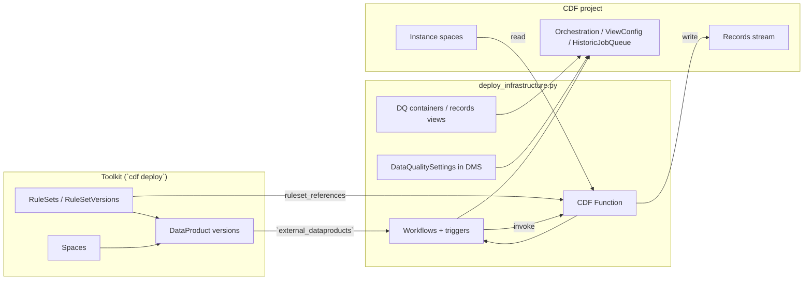
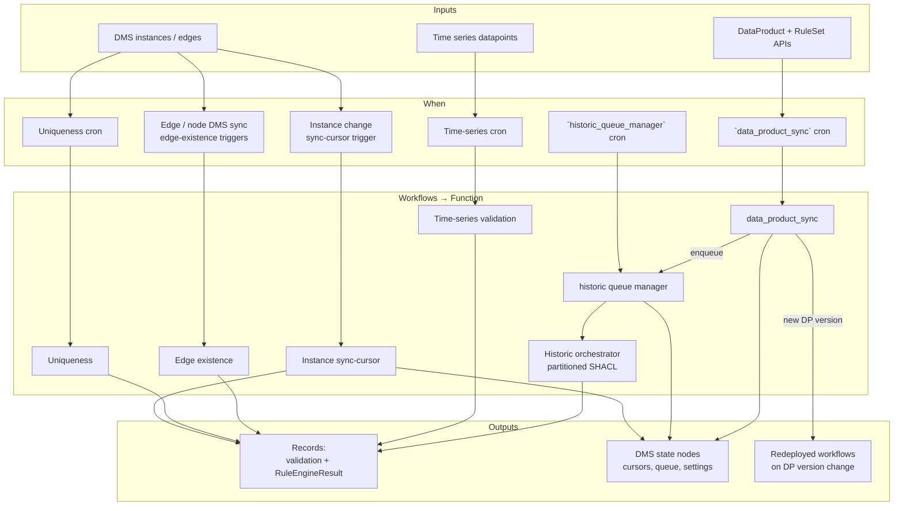

# Data Quality Validation

## Overview

Publishes SHACL **RuleSets** and **DataProducts** with Cognite Toolkit (`cdf deploy`), then runs the same Python deploy path as [data-quality-validation-deploy](https://github.com/cognitedata/data-quality-validation-deploy) (`scripts/deploy_infrastructure.py`).

Bundled sample: cog-ai **YourOrg** (`config/environments/cog-ai`).

| Layer | Toolkit (`cdf deploy`) | Module script (`deploy_infrastructure.py`) |
| --- | --- | --- |
| RuleSets / DataProducts | Yes | Consumes via `external_dataproducts` |
| Function + containers | — | Yes |
| Instance workflows | — | Yes (external DataProduct + `views/` overrides) |
| Time-series workflows | — | Yes (`timeseries/` configs) |
| `data_product_sync` + historic queue | — | Yes (`data_product_sync_cron`) |

Only `dq_pypi_version` is in `default.config.yaml`.

## Process and data flow

Two deploy stages, then continuous validation at runtime. All validation paths invoke the same CDF Function (`cognite-data-quality`); workflows differ by **when** they fire and **what** they ask the function to do.

### Deploy → runtime



### Runtime validation paths



### Workflows: when they run and what they do

Prefixes and crons below match this module’s `settings.yaml` / sample `views/` and `timeseries/` (customize per project).

| Workflow | Trigger / schedule | What it does |
| --- | --- | --- |
| **Instance sync-cursor** (`dq-shacl-…`) | DMS data-change trigger (batched: `trigger.batch_size` / `batch_timeout`) | Incremental SHACL on changed instances since the last cursor; writes validation records. One consolidated workflow per view (or DataProduct grouping). Does **not** run uniqueness. |
| **Uniqueness** (`…-uniqueness`) | Cron — from SHACL `dqs:schedule`, or view `uniqueness_cron` (sample: Equipment `0 */4 * * *`, MaintenanceOrder `2 * * * *`; default often `0 6 * * *`) | Global uniqueness checks declared in RuleSet (`dqs:uniquenessConstraint` / `dqs:unique`). Created only when SHACL has uniqueness for that view. |
| **Edge existence** (`…-edge-existence`) | Two DMS sync triggers per rule (node + edge), no backfill | Typed-edge cardinality (`dqs:edgeExistenceConstraint`). Deploy-time triggers; baseline over in-scope nodes also runs as part of historic orchestration when rules/DP version change. |
| **Time-series** (`dq-ts-shacl-…`) | Cron from `timeseries/*.yaml` (sample: `2 * * * *`) | Datapoint SHACL for filtered series; RuleSets whose `sh:targetClass` matches the timeseries view. |
| **`data_product_sync`** | Cron `data_product_sync_cron` (sample: `13 * * * *`) | Loads managed / external DataProducts; if version or rules changed, redeploys instance/uniqueness/edge/timeseries workflows and may **enqueue historic** jobs for affected views. |
| **Historic queue manager** (`dq-historic-queue-manager`) | Cron ~every 5 minutes (package default) | Drains `HistoricJobQueue` **sequentially** (one orchestration at a time); starts the next job when the current completes or fails; supersedes older queued jobs for the same view when a newer DP version lands. |
| **Historic orchestrator** (function, not a standing WF id) | Started by queue manager or `deploy_pipeline.py` / `--enqueue-historic` | Partitioned full-history SHACL for a view; then hands off to sync-cursor + a short-lived **Monitor** function schedule (~every 2 min) until orchestration finishes. |
| **Monitor `{view}` validation** | Function schedule ~every 2 min while historic is `in_progress` / `monitoring` | Retriggers the orchestrator in monitor mode; if the schedule is missing while state is still active, the queue manager marks the job failed (orphaned) so the queue does not block. |

Optional (not in this sample): **`rule_engine_result_sync`** listener workflows — scheduled consumers of `RuleEngineResult` records for rule chaining.

### Data movement (short)

1. **Catalog** — Toolkit publishes RuleSets and DataProduct versions (views + `instanceSpaces` + `quality.rules`).
2. **Wire-up** — Python deploy creates the Function, state containers in `config_space` (`dataQuality`), workflows/triggers from `external_dataproducts` + optional `views/` / `timeseries/` overrides, and persists `DataQualitySettings` / `ViewConfigState`.
3. **Steady state** — Change triggers and crons invoke the Function; it reads instances (or datapoints) and RuleSets, writes **Records** to `records.space` / `records.stream_id`, and updates cursors / orchestration state in DMS.
4. **Version bump** — `data_product_sync` detects a new DataProduct/RuleSet version → redeploys workflows → enqueues historic → queue manager runs full revalidation, then incremental sync resumes.

### Where quality-job results are stored (records)

Validation outputs are **Records** (not DMS instances). This module does **not** ship Toolkit `*.Container.yaml` for those schemas.

| What | Where it is defined / applied |
| --- | --- |
| Result container schemas | [`cognite-data-quality`](https://github.com/cognitedata/data-quality-validation) package (`cognite_data_quality/_records.py`), applied by `deploy_validation_infrastructure()` / `deploy_infrastructure.py` |
| Validation results | Container `DataQualityValidationRecord` (`usedFor: record`) in `records.space` |
| SHACL-AF / rule-engine inferences | Container `RuleEngineResult` (`usedFor: record`) in the same space |
| Record views | Same external IDs, version `v1`, bound to `records.stream_id` |
| Stream + space target | This module’s `settings.yaml` → `records.space` / `records.stream_id` (sample: `dataQuality` / `test_stream_1`) |

Field reference: [Records output](https://cognite-data-quality-validation.readthedocs-hosted.com/en/latest/usage/records_output.html). Create the stream in CDF before or alongside deploy; the package ensures the containers and views, not the stream itself.

See also: [Deploy infrastructure](https://cognite-data-quality-validation.readthedocs-hosted.com/en/latest/usage/deploy.html), [Lifecycle and CI/CD](https://cognite-data-quality-validation.readthedocs-hosted.com/en/latest/usage/lifecycle.html).

## Prerequisites

RuleSets and DataProducts require the Toolkit [`data-products` alpha flag](https://docs.cognite.com/cdf/deploy/cdf_toolkit/api/alpha_flags#alpha-flag-data-products) (Toolkit `0.7.207+`). Enable it in `cdf.toml` before `cdf build`:

```toml
[alpha_flags]
data-products = true
```

The `[alpha_flags]` header must be uncommented. If only `data-products = true` is set (for example under `[plugins]`), Toolkit ignores it: `cdf build` emits only the space under `data_modeling/` and skips `rulesets/` / `data_products/`. Then `deploy_infrastructure.py` fails with `Data product version 'enterprise-process-industry:1.1.10' not found` (404).

After enabling the flag, run `cdf build && cdf deploy` so version `1.1.10` exists in CDF before the Python script.

### Access control

The identity used by `cdf deploy` and `deploy_infrastructure.py` (Toolkit `.env` / `IDP_*` service principal or user) needs these capabilities on the CDF project. Actions are `CREATE`, `READ`, `UPDATE`, and `DELETE` (there is no `WRITE`):

| Capability | Needed for |
| --- | --- |
| `dataProductsAcl:CREATE` / `UPDATE` / `DELETE` | Create/update/delete DataProducts via `cdf deploy` |
| `dataProductsAcl:READ` | `deploy_infrastructure.py` loading external DataProducts (for example `enterprise-process-industry`) when deploying workflows |
| `ruleSetsAcl:CREATE` / `READ` / `UPDATE` / `DELETE` | Create/update/delete RuleSets and RuleSetVersions via `cdf deploy` |

Grant these (typically all actions, scope `all`) in Fusion → Access management on the group linked to that identity — for Toolkit this is often `cognite_toolkit_service_principal`.

Common errors:

```text
CogniteAPIError: Missing capability DataProducts:READ | code: 403
CogniteAPIError: Missing capability RuleSets:CREATE | code: 403
Data product version 'enterprise-process-industry:1.1.10' not found | code: 404
```

The 404 means Toolkit has not deployed that DataProduct version yet (alpha flag off, or `cdf deploy` not run / failed).

Spaces used by the sample are defined under `data_modeling/` and created by `cdf deploy`: `sp_enterprise_process_industry` (schema), `springfield_instances` and `test_data_pumps` (instances), and `dataQuality` (runtime / `settings.yaml` `config_space`). Change the DataProductVersion YAML if your project uses different instance spaces.

## Operator flow

### Local

```bash
cdf modules add dp:data_quality
# Ensure data-products = true under [alpha_flags] in cdf.toml (see Prerequisites)
cdf build && cdf deploy                    # RuleSets + DataProducts
pip install cognite-data-quality==0.4.9
python modules/common/cdf_dq_runtime/scripts/deploy_infrastructure.py \
  --toolkit-config config.dev.yaml
```

### Build notes

**`IgnoredFileWarning` for `timeseries/yourorg_timeseries_quality.yaml`**

Toolkit treats `timeseries/` as a CDF TimeSeries resource directory, so it warns that this file has no kind suffix (for example `.TimeSeries.yaml`) and ignores it. That is expected: the YAML is config for `deploy_infrastructure.py`, not a Toolkit TimeSeries resource. The warning is harmless; build and deploy can continue.

Credentials come from the Toolkit project ``.env`` (next to ``cdf.toml``) when present,
then environment variables (same as [data-quality-validation-deploy](https://github.com/cognitedata/data-quality-validation-deploy)):
``COGNITE_PROJECT``, ``COGNITE_CLIENT_ID``, ``COGNITE_CLIENT_SECRET``, and ``AZURE_TENANT_ID`` or ``COGNITE_TOKEN_URL``.
In Toolkit projects, ``CDF_*`` / ``IDP_*`` work too. Optionally pass ``--config-toml`` for a local gitignored TOML file (notebooks).

Optional historic enqueue (same as deploy repo `--enqueue-historic`):

```bash
python modules/common/cdf_dq_runtime/scripts/deploy_infrastructure.py \
  --toolkit-config config.dev.yaml --enqueue-historic
```

Per-view historic pipeline:

```bash
python modules/common/cdf_dq_runtime/scripts/deploy_pipeline.py \
  --view-external-id YourOrgAsset --historic-mode enqueue --toolkit-config config.dev.yaml
```

### CI/CD

Run `deploy_infrastructure.py` in the same GitHub Actions job as `cdf deploy`, reusing the Toolkit environment block (`IDP_*`, `CDF_*`). Do not generate a credentials file. See [Toolkit pack CI/CD](https://github.com/cognitedata/data-quality-validation/blob/main/docs/usage/toolkit_pack.md#cicd).

## Contents (cog-ai sample)

**Views:** `YourOrgAsset`, `YourOrgEquipment`, `YourOrgMaintenanceOrder`, `YourOrgNotification`, `YourOrgOperation`, `YourOrgTimeSeries`

**Time-series config:** `yourorg_timeseries_quality` only (no demo data generator / `demo_timeseries_quality`).

**RuleSets:** matching `*_shacl_rules` / `timeseries_quality_rules` from deploy repo (inline in `rulesets/`)

**Settings:** `settings.yaml` mirrors cog-ai workflow prefixes, records stream, `data_product_sync_cron`, and `timeseries.config_dir`.

## Support

- [data-quality-validation](https://github.com/cognitedata/data-quality-validation)
- [data-quality-validation-deploy (cog-ai)](https://github.com/cognitedata/data-quality-validation-deploy/tree/main/config/environments/cog-ai)
