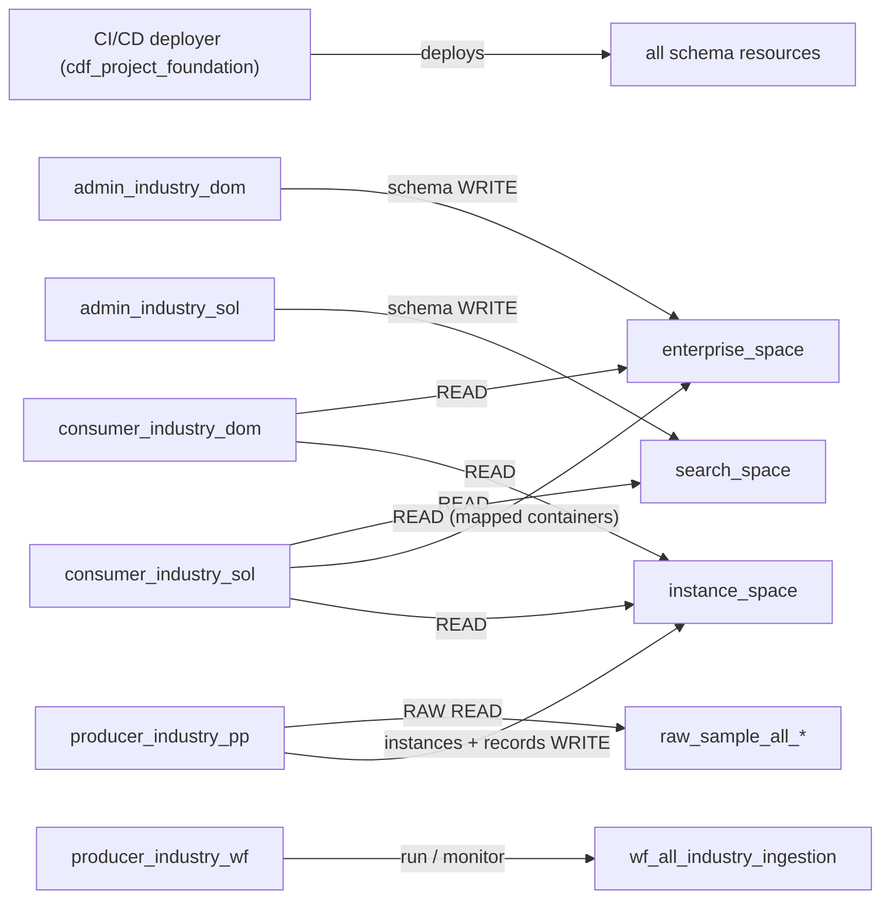

# Simplified Industry Domain Data Model Template — Plan & Spec

> **Status:** Plan for review and build in this repository (`cognitedata/library`).
> **Audience:** Developers and agents scaffolding and adapting the modules below.
> **Standards:** cog-vd `cdf-data-modeling`, `cdf-transformation`, `cdf-workflow`, `cdf-naming-check` skills,
> `cdf-naming-conventions` rule, and the Cognite docs (core data model, process industry data model, Toolkit
> resource library).
> **Layout patterned after:** `cfihos_oil_and_gas_extension` + its `sourcesystem/*_data_dump` and
> `common/cdf_ingestion` companions (structure, Toolkit variables, sample data — **no CFIHOS or ISA content**).

---

## 1. Goal

Ship a **small, industry-neutral** reusable domain data model template that works for any asset-heavy industry
(process, manufacturing, utilities, energy, mining, infrastructure):

- Same Toolkit folder shape as the existing `datamodels/*_extension` modules.
- **Only** CDM / IDM extensions (`implements` on domain views) plus two label-only custom types.
- Reuse CDM/IDM properties and type nodes wherever they exist; custom properties only for what CDM/IDM lack.
- Custom containers/views **must not** implement or require `CogniteDescribable`.
- Scaffold properties clearly marked so an agent can rename, replace or delete them when wiring real source systems
  (§8.0).
- Companion Search `_SOL` data product: a **schema only** (views + data model) that maps enterprise containers and
  adds reverse relations — no containers, no transformations, no data of its own.
- One high-volume event type as **records** (`AlarmEvent`, `usedFor: record`) in a stream, linked to the graph by
  direct relations (§5.11).
- Sample data, transformations and a workflow so the template runs end to end out of the box.
- Every rule in §9 (validation gate) passes before the template ships.

---

## 2. Decisions locked

| Decision | Choice |
|----------|--------|
| Home | `modules/datamodels/` (pack `dp:models`), sample data in `modules/sourcesystem/`, workflow in `modules/common/` |
| Layers | Enterprise `_DOM` + companion Search `_SOL`; no `_SRC` model (RAW → enterprise directly) |
| Asset hub | `Tag` implements `cdf_cdm:CogniteAsset` (one asset view per model) |
| Industry standards | **Excluded** — no CFIHOS, ISA-95/88, RDS or other standard-specific classes or coded properties |
| CDM/IDM reuse | IDM `status` / `type` / `priority`, CDM `equipmentType`, `category`, `manufacturer`, `serialNumber` instead of custom duplicates |
| Custom types | Local `name` only — **no** `CogniteDescribable` |
| Location | Canonical on `Tag` in enterprise; search reaches it by navigating the asset relation (no copies) |
| Search `_SOL` | Schema-only data product: views + data model mapping `{{ enterprise_space }}` / CDM / IDM containers; **no** containers, transformations or instance writes |
| Reverse directs | On Search `_SOL` only — **not** on domain views |
| Event records | `AlarmEvent` record container + record view in the enterprise space, stream `{{ alarm_stream_external_id }}` (immutable); records stored in `{{ instance_space }}`; loaded by a CDF Function (Records cannot be onboarded through RAW + Transformations) |
| Access | Six persona-led groups (cog-vd `<persona>_industry_<type>_<env>` with type vocabulary `dom`/`sol`/`pp`/`wf`): DOM admin / consumer, SOL admin / consumer, pipeline producer, pipeline operator; only the pipeline writes data (§11.1). Search + alarms → dual membership |
| Instance space | One shared `inst_industry` — **documented exception** (§11.3); function code in separate `{{ function_space }}` |
| Tag labels | CogniteDescribable `tags` exposed as view property `labels` on `Tag` / `SearchTag` (§5.1.1) |
| Versions | `{{dm_enterprise_version}}` and `{{dm_search_version}}` — never shared; AlarmEvent record view uses enterprise version |
| Variables | Same snake_case variable names in all six modules (§3.2) |

---

## 3. Modules to create

| Module | Path | Role |
|--------|------|------|
| Enterprise | `modules/datamodels/industry_domain_extension` | Node containers + domain views (`implements` CDM/IDM), `AlarmEvent` record container + record view + stream, auth groups, data set, enterprise location filter |
| Search | `modules/datamodels/industry_domain_extension_search` | Schema only: Search views mapping enterprise/CDM/IDM containers, reverses, DataModel, search location filter |
| SAP sample data | `modules/sourcesystem/cdf_sap_industry_data_dump` | RAW db + tables, sample rows, SAP transformations into `Industry_DOM` |
| PI sample data | `modules/sourcesystem/cdf_pi_industry_data_dump` | RAW db + tables, sample rows, time series + operating limit transformations, alarm event record ingestion Function |
| SharePoint sample data | `modules/sourcesystem/cdf_sharepoint_industry_data_dump` | RAW db + tables, sample rows, document + diagram annotation transformations |
| Ingestion | `modules/common/cdf_industry_ingestion` | One workflow that runs all industry transformations, its trigger, and auth groups |

The split mirrors CFIHOS: `cfihos_oil_and_gas_extension` owns schema/auth/data set/location; the
`cdf_sap_data_dump`, `cdf_pi_data_dump`, `cdf_sharepoint_data_dump` modules own RAW data and transformations;
`common/cdf_ingestion` owns the orchestration workflow (§12).

### 3.1 Target tree (data model modules)

```
industry_domain_extension/
  module.toml                    # id = dp:models:industry_domain_extension
  default.config.yaml
  README.md                      # incl. "How to extend" (§8.0), "Stable contract vs scaffolding", "Adapting this template"
  SPEC.md                        # full agent contract from this plan §8 (lead with §8.0)
  auth/
    dom_admin.Group.yaml         # name {{ dom_admin_group_name }}
    dom_consumer.Group.yaml      # name {{ dom_consumer_group_name }}
  data_sets/
    dataset.DataSet.yaml         # externalId {{ dataset_external_id }}
  locations/
    enterprise.LocationFilter.yaml   # externalId {{ enterprise_location_filter_external_id }}
  streams/
    alarm.Streams.yaml           # externalId {{ alarm_stream_external_id }}, template {{ alarm_stream_template }}
  data_modeling/
    enterprise.Space.yaml        # {{ enterprise_space }}
    instance.Space.yaml          # {{ instance_space }}
    enterprise.DataModel.yaml    # {{ enterprise_data_model_external_id }}
    containers/
      Tag.Container.yaml
      Equipment.Container.yaml
      Document.Container.yaml
      TimeSeriesData.Container.yaml
      WorkOrder.Container.yaml
      Notification.Container.yaml
      Material.Container.yaml
      OperatingLimit.Container.yaml
      AlarmEvent.Container.yaml      # usedFor: record — no constraints, no indexes
    views/
      Tag.View.yaml
      Equipment.View.yaml
      Document.View.yaml
      TimeSeriesData.View.yaml
      WorkOrder.View.yaml
      WorkOrderOperation.View.yaml   # no own container — IDM properties only
      Notification.View.yaml
      Material.View.yaml
      OperatingLimit.View.yaml
      AlarmEvent.View.yaml           # record view (streamId + version); not listed in the DataModel

industry_domain_extension_search/
  module.toml                    # id = dp:models:industry_domain_extension_search
  default.config.yaml
  README.md
  auth/
    sol_admin.Group.yaml         # name {{ sol_admin_group_name }}
    sol_consumer.Group.yaml      # name {{ sol_consumer_group_name }}
  locations/
    search.LocationFilter.yaml   # externalId {{ search_location_filter_external_id }}
  data_modeling/
    search.Space.yaml            # {{ search_space }} — schema space for views only
    search.DataModel.yaml        # {{ search_data_model_external_id }}
    views/                       # no containers/ and no transformations/ in this module
      SearchTag.View.yaml
      SearchEquipment.View.yaml
      SearchDocument.View.yaml
      SearchTimeSeriesData.View.yaml
      SearchWorkOrder.View.yaml
      SearchWorkOrderOperation.View.yaml
      SearchNotification.View.yaml
      SearchMaterial.View.yaml
      SearchOperatingLimit.View.yaml
```

Resource files are named by **role**, not by identifier, so renaming a space, data model, data set or location filter
is a config-only change. Container and view files keep their PascalCase `externalId` (Toolkit convention).
Source-system and ingestion trees are in §12.1.

### 3.2 Shared variables (identical names in all six modules)

Every module declares only the variables it uses, but **the same concept always has the same variable name**. A
project overrides them once at the `variables.modules` level of `config.<env>.yaml`, and every module picks them up.

```yaml
# Data model identifiers
enterprise_space: dm_dom_industry
search_space: dm_sol_industry_search
instance_space: inst_industry
function_space: sp_function_industry          # function code only — never instance_space (cdf_common pattern)
enterprise_data_model_external_id: Industry_DOM
enterprise_data_model_name: Industry DM DOM
search_data_model_external_id: IndustrySearch_SOL
search_data_model_name: Industry search DM SOL
dm_enterprise_version: v1
dm_search_version: v1

# Governance
dataset_external_id: ds_industry_all
dataset_name: Industry domain model
enterprise_location_filter_external_id: loc_industry_all
enterprise_location_filter_name: Industry all locations
search_location_filter_external_id: loc_industry_search_all
search_location_filter_name: Industry search all locations

# Access groups — persona-led, the only identifiers that carry the environment token (override per config.<env>.yaml)
# Type tokens for this template: dom | sol | pp | wf (§8.8 / §11.1 vocabulary)
dom_admin_group_name: admin_industry_dom_dev
dom_consumer_group_name: consumer_industry_dom_dev
sol_admin_group_name: admin_industry_sol_dev
sol_consumer_group_name: consumer_industry_sol_dev
ingestion_group_name: producer_industry_pp_dev
operator_group_name: producer_industry_wf_dev
dom_admin_source_id: ${DOM_ADMIN_GROUP_SOURCE_ID}
dom_consumer_source_id: ${DOM_CONSUMER_GROUP_SOURCE_ID}
sol_admin_source_id: ${SOL_ADMIN_GROUP_SOURCE_ID}
sol_consumer_source_id: ${SOL_CONSUMER_GROUP_SOURCE_ID}
ingestion_source_id: ${INGESTION_GROUP_SOURCE_ID}
operator_source_id: ${OPERATOR_GROUP_SOURCE_ID}

# Records
alarm_stream_external_id: pi_all_alarm_event
# Sample/dev default only. Template is fixed at stream creation — set BasicArchive before any non-dev deploy (§5.11).
alarm_stream_template: ImmutableTestStream
alarm_function_external_id: fn_pi_all_ingest_alarm_event

# Sample data and processing
raw_database_sap: raw_sample_all_sap
raw_database_pi: raw_sample_all_pi
raw_database_sharepoint: raw_sample_all_sharepoint
workflow_external_id: wf_all_industry_ingestion
workflow_trigger_external_id: trigger_wf_all_industry_ingestion
ingestion_client_id: ${IDP_CLIENT_ID}
ingestion_client_secret: ${IDP_CLIENT_SECRET}
run_workflow_schedule: "0 0 29 2 *"   # intentionally never; the sample workflow is run manually
```

Naming checks applied (cog-vd `cdf-naming-conventions` + `cdf-data-model-limits`):

- Data models: PascalCase + layer suffix; names in sentence case (`Industry DM DOM`, `Industry search DM SOL`).
- DM spaces: `dm_{dom|sol}_{snake_case}`; instance space: `inst_{snake_case}`; function space: `sp_function_*`
  (code upload only — separate from instances).
- Location filters: `loc_{location}` with `all` because the template is not scoped to one site.
- Data set: `ds_{data_type}_{location}`, shared by the model, transformations and workflow.
- Streams: snake_case `{source}_{location}_{concept}`; functions: `fn_{source}_{location}_{intent}_{target}`;
  record external IDs: `{source}_{location}_{machine}_{id}` (e.g. `pi_all_<tag>_<eventTime>_<eventType>`).
- Views and containers: PascalCase, **singular**, and not on the reserved list (`File`, `TimeSeries`, … are
  rejected by CDF — hence `Document` and `TimeSeriesData`).
- Display names: sentence case — spaces (`Industry DM DOM`, `Industry search DM SOL`, `Industry instance space`,
  `Industry function space`), views/containers (`Time series data`, `Work order operation`, `Search work order`),
  location filters, data set.
- No environment tokens (`dev` / `test` / `prod`) and no customer or site names in any identifier — except the
  required `<environment>` suffix on persona-led access group names (set per `config.<env>.yaml`).
- Access group type tokens for this template are the project vocabulary in §8.8 (`dom`, `sol`, `pp`, `wf`).
- Template targets **CDM `v1` and IDM `v1`**; CDM/IDM view versions are hard-coded `v1`.

### 3.3 module.toml

```toml
# enterprise
[module]
title = "Industry Domain Data Model template"
id = "dp:models:industry_domain_extension"
package_id = "dp:models"

# search
[module]
title = "Industry Domain Search Data Model template"
id = "dp:models:industry_domain_extension_search"
package_id = "dp:models"
```

Registry changes for all six modules are in §13.

---

## 4. Architecture

```mermaid
flowchart TB
  subgraph cdm [cdf_cdm and cdf_idm]
    CogniteAsset
    CogniteEquipment
    CogniteEquipmentType
    CogniteFile
    CogniteFileCategory
    CogniteTimeSeries
    CogniteMaintenanceOrder
    CogniteOperation
    CogniteNotification
  end

  subgraph dom [Industry_DOM]
    Tag
    Equipment
    Document
    TimeSeriesData
    WorkOrder
    WorkOrderOperation
    Notification
    Material
    OperatingLimit
  end

  subgraph rec ["Stream pi_all_alarm_event (records)"]
    AlarmEvent["AlarmEvent record view"]
  end

  subgraph sol [IndustrySearch_SOL]
    SearchTag
    SearchEquipment
    SearchDocument
    SearchTimeSeriesData
    SearchWorkOrder
    SearchWorkOrderOperation
    SearchNotification
    SearchMaterial
    SearchOperatingLimit
  end

  Tag -->|implements| CogniteAsset
  Equipment -->|implements| CogniteEquipment
  Document -->|implements| CogniteFile
  TimeSeriesData -->|implements| CogniteTimeSeries
  WorkOrder -->|implements| CogniteMaintenanceOrder
  WorkOrderOperation -->|implements| CogniteOperation
  Notification -->|implements| CogniteNotification
  Equipment -->|equipmentType| CogniteEquipmentType
  Document -->|category| CogniteFileCategory

  SearchTag -->|maps containers| Tag
  SearchWorkOrder -->|"maps IDM + WorkOrder containers"| WorkOrder

  AlarmEvent -->|asset| Tag
  AlarmEvent -->|timeSeries| TimeSeriesData
  AlarmEvent -->|operatingLimit| OperatingLimit
```



`AlarmEvent` lives in `{{ enterprise_space }}` but outside the `Industry_DOM` data model (record views can't be
members of a data model yet).

---

## 5. Enterprise content

### 5.1 CDM/IDM extensions — CONTRACT wiring + SOURCE_SCAFFOLD props

Mark every custom property description with a leading tag agents can grep:

- `CONTRACT:` — do not remove without understanding CDM/IDM / app impact
- `SOURCE_SCAFFOLD:` — safe to rename/replace/delete before first production deploy

| View | implements | Own container (requires) | SOURCE_SCAFFOLD properties | CDM/IDM properties used instead of custom ones |
|------|------------|--------------------------|----------------------------|-----------------------------------------------|
| **Tag** | `CogniteAsset` | `Tag` (`cdf_cdm:CogniteAsset`) | `site`, `area`, `system`, `tagClass` | `name`, `description`, `aliases`, `labels` (alias of CogniteDescribable `tags` — see §5.1.1), `parent`, `sourceId` |
| **Equipment** | `CogniteEquipment` | `Equipment` (`cdf_cdm:CogniteEquipment`) | `modelNumber` | `equipmentType` (→ CogniteEquipmentType: `code`, `equipmentClass`, `standard`, `standardReference`), `manufacturer`, `serialNumber`, `asset`, `files` |
| **Document** | `CogniteFile` | `Document` (`cdf_cdm:CogniteFile`) | `documentNumber`, `disciplineCode`, `revision`; source-native `site`, `area`, `system` | `category` (→ CogniteFileCategory for the document type), `mimeType`, `assets` |
| **TimeSeriesData** | `CogniteTimeSeries` | `TimeSeriesData` (`cdf_cdm:CogniteTimeSeries`) | `timeSeriesSource` enum (`Historian` / `OpcUa` / `Other`), `historianTagName`, `historianPointSource` | `type`, `isStep`, `sourceUnit`, `assets`, `equipment` |
| **WorkOrder** | `CogniteMaintenanceOrder` | `WorkOrder` (`cdf_idm:CogniteMaintenanceOrder`) | `workOrderNumber` | `status`, `type`, `priority`, `mainAsset`, `assets`, `scheduledStartTime`, `scheduledEndTime`, `startTime`, `endTime` |
| **WorkOrderOperation** | `CogniteOperation` | **none** — no custom properties | — | `status`, `phase`, `sequence`, `mainDiscipline`, `personHours`, `maintenanceOrder`, `mainAsset`, `assets` |
| **Notification** | `CogniteNotification` | `Notification` (`cdf_idm:CogniteNotification`) | `failureModeCode`, `detectionMethodCode` | `status`, `type`, `priority`, `priorityDescription`, `asset`, `maintenanceOrder`, `sourceId` |

Rules:

- Never add a custom property for a field CDM/IDM already has (§8.4); no container is created for a type with no
  custom properties (WorkOrderOperation).
- **Do not** re-require Describable / Sourceable / Schedulable / Activity when the parent CDM/IDM container already
  requires them.
- `workOrderNumber` is kept only because the source `order` number differs from the instance key; if the source
  order number equals `sourceId`, delete it.

#### 5.1.1 Property alias — `labels` ← CogniteDescribable `tags` (required on Tag)

Because the CogniteAsset view in this model is named `Tag`, the inherited Describable property `tags` (text-based
labels) collides with the view name and its direct relations (cog-vd *Property Aliasing — labels vs tags*; same
pattern as CFIHOS). **Both** the enterprise `Tag` view and `SearchTag` must expose it as `labels`:

```yaml
# Tag.View.yaml and SearchTag.View.yaml
labels:
  name: Labels
  description: "CONTRACT: Text-based labels (CogniteDescribable.tags). Aliased to labels because the view is named Tag."
  container:
    space: cdf_cdm
    externalId: CogniteDescribable
    type: container
  containerPropertyIdentifier: tags
```

- Transformations and queries that target `Tag` / `SearchTag` use the view property id `labels` (e.g. SQL
  `AS labels`), never `tags`.
- Other views that `implements` CDM/IDM may keep the inherited property name `tags` (no collision).
- Enterprise and Search READMEs include the same naming note as CFIHOS.

### 5.2 Typed relation overrides (domain views)

Every inherited CDM/IDM direct relation a domain view exposes gets `source` pointing at the **most specific** view in
`Industry_DOM` (cog-vd relation checklist item 9):

| View | Property | source view |
|------|----------|-------------|
| Tag | `parent`, `root` | Tag |
| Equipment | `asset` | Tag |
| Equipment | `files` | Document |
| Equipment | `equipmentType` | `cdf_cdm:CogniteEquipmentType` |
| Document | `assets` | Tag |
| Document | `category` | `cdf_cdm:CogniteFileCategory` |
| TimeSeriesData | `assets` | Tag |
| TimeSeriesData | `equipment` | Equipment |
| WorkOrder | `mainAsset`, `assets` | Tag |
| WorkOrder | `equipment` / `timeSeries` | Equipment / TimeSeriesData |
| WorkOrderOperation | `mainAsset`, `assets` | Tag |
| WorkOrderOperation | `maintenanceOrder` | WorkOrder |
| WorkOrderOperation | `equipment` / `timeSeries` | Equipment / TimeSeriesData |
| Notification | `asset` | Tag |
| Notification | `maintenanceOrder` | WorkOrder |
| Notification | `equipment` / `timeSeries` | Equipment / TimeSeriesData |

`path` stays a CDM-managed list; `TimeSeriesData.unit` stays sourced to `cdf_cdm:CogniteUnit`.
**No reverse directs** on these domain views.

### 5.3 CDM type nodes

`CogniteEquipmentType` and `CogniteFileCategory` are used as-is from `cdf_cdm` (no domain view, no container). Both
views are listed in `Industry_DOM` and `IndustrySearch_SOL` so transformations and apps can reach them. Type nodes
live in `{{ instance_space }}`; their external IDs are the source codes.

### 5.4 Custom types — no CogniteDescribable

| View / Container | Pattern | Properties |
|------------------|---------|------------|
| **Material** | Local `name` text; `usedFor: node`; **no** CDM requires | `name`, `materialType`, `equipment` → Equipment, `asset` → Tag |
| **OperatingLimit** | Local `name`; operating limits for a measured value | `name`, `timeSeries` → TimeSeriesData, `limitHigh`, `limitLow` (float64), `limitHighConsequence`, `limitLowConsequence`, `limitHighCorrectiveAction`, `limitLowCorrectiveAction` |

Domain views: **no** `implements`. Every navigated direct has view `source` + container btree index.

### 5.5 Explicitly excluded

- Industry-standard class hierarchies and coded property keys (CFIHOS, ISA-95/88, RDS, …)
- Functional-location class views, failure-mode / reliability models
- More record types (PI event frames, OPC UA events, batch logs) — add them with the §5.11 pattern
- Custom duplicates of CDM/IDM fields (§8.4)

### 5.6 Location (no denormalization)

| Layer | Rule |
|-------|------|
| Enterprise | Location context on **Tag** (`site`, `area`, `system`) + CogniteAsset hierarchy. Do **not** copy it onto other enterprise containers. |
| Enterprise – Document (exception) | The `Document` container (implements CogniteFile) may keep **source-native** `site` / `area` / `system` because the document register owns them (`SOURCE_SCAFFOLD`) — not copies of Tag. |
| Search `_SOL` | No copies. `SearchTag` maps the Tag location; other search views reach it through their typed asset direct (`asset` / `mainAsset` / `assets` → `SearchTag`). `SearchDocument` maps the source-native Document location. |

### 5.7 Indexes and descriptions (every container)

- Set `usedFor` explicitly on every container: `node` for the eight entity containers, `record` for `AlarmEvent`
  (§5.11)
- `usedFor: node`: include `constraints` and `indexes` keys; stay under 100 properties / 10 indexes per container
- `usedFor: record`: **no** `constraints` and **no** `indexes` keys; up to 1,000 properties; the rules below on
  indexes do not apply
- btree on every owned scalar direct that is filtered or traversed
- Before btree on `direct[]`, set `maxListSize` ≤ 300
- btree on lookup keys: `workOrderNumber`, `documentNumber`, `site`, `area`, `system` — with `maxTextSize` ≤ 2400
- Property descriptions: domain sentence + example value; every view property has a description
- Closed value sets → container `enum` (e.g. `timeSeriesSource`); no reserved enum values (`true`, `false`, `null`)

### 5.8 YAML pattern — CDM extension container

```yaml
space: "{{ enterprise_space }}"
externalId: Tag
name: Tag
description: Enterprise tag / functional location hub. Extends CogniteAsset.
usedFor: node
properties:
  site:
    type: { list: false, collation: ucs_basic, type: text }
    nullable: true
    autoIncrement: false
    immutable: false
    name: Site
    description: "SOURCE_SCAFFOLD: Site or plant code. Example: PLANT01."
    maxTextSize: 2400
  # ... area, system, tagClass ...
constraints:
  requiresCogniteAsset:
    constraintType: requires
    require:
      space: cdf_cdm
      externalId: CogniteAsset
      type: container
indexes:
  site:
    indexType: btree
    properties: [site]
    cursorable: false
```

### 5.9 YAML pattern — CDM extension view

```yaml
space: "{{ enterprise_space }}"
externalId: Tag
name: Tag
description: Enterprise tag view. CONTRACT: implements CogniteAsset; one asset view in this model.
implements:
  - space: cdf_cdm
    externalId: CogniteAsset
    version: v1
    type: view
version: "{{ dm_enterprise_version }}"
properties:
  site:
    name: Site
    description: "SOURCE_SCAFFOLD: Site or plant code. Example: PLANT01."
    container:
      space: "{{ enterprise_space }}"
      externalId: Tag
      type: container
    containerPropertyIdentifier: site
  parent:
    name: Parent
    description: "CONTRACT: Hierarchy parent; sourced to enterprise Tag."
    container:
      space: cdf_cdm
      externalId: CogniteAsset
      type: container
    containerPropertyIdentifier: parent
    source:
      space: "{{ enterprise_space }}"
      externalId: Tag
      version: "{{ dm_enterprise_version }}"
      type: view
```

### 5.10 YAML pattern — custom type without Describable

```yaml
# Material.Container.yaml — no requires CogniteDescribable
space: "{{ enterprise_space }}"
externalId: Material
name: Material
description: Spare part or bill-of-materials item linked to equipment or tag. Label-only; no CogniteDescribable.
usedFor: node
properties:
  name:
    type: { list: false, collation: ucs_basic, type: text }
    nullable: true
    name: Name
    description: "SOURCE_SCAFFOLD: Display label for the material. Example: Gasket DN50."
  equipment:
    type: { list: false, type: direct }
    nullable: true
    name: Equipment
    description: "CONTRACT: Direct relation to Equipment."
# No constraints key unless there is a real requires — omit empty constraints: {} (anti-pattern §10)
indexes:
  equipment:
    indexType: btree
    properties: [equipment]
    cursorable: true
```

```yaml
# Material.View.yaml — no implements
space: "{{ enterprise_space }}"
externalId: Material
name: Material
description: Material access view. No CogniteDescribable.
version: "{{ dm_enterprise_version }}"
properties:
  equipment:
    name: Equipment
    description: "CONTRACT: Equipment this material belongs to."
    container:
      space: "{{ enterprise_space }}"
      externalId: Material
      type: container
    containerPropertyIdentifier: equipment
    source:
      space: "{{ enterprise_space }}"
      externalId: Equipment
      version: "{{ dm_enterprise_version }}"
      type: view
```

### 5.11 Event records — `AlarmEvent` (`usedFor: record`)

Alarms are high-volume, write-once events, so they are **records in a stream**, not nodes (Cognite docs *About
records and streams*: storing each event as a node degrades graph performance and consumes instance budget). Each
state change (raised, acknowledged, cleared) is a new record — this fits an immutable stream.

| Resource | File | Rule |
|----------|------|------|
| Stream | `streams/alarm.Streams.yaml` | `externalId: {{ alarm_stream_external_id }}`; `settings.template.name: {{ alarm_stream_template }}`. Default in sample config is `ImmutableTestStream` (**dev / experimentation only**, short retention). The template **cannot be changed** after creation — set `BasicArchive` in `config.<env>.yaml` **before the first non-dev deploy** (and before any deploy that must retain sample alarms). Stream limits per project are small (1 `BasicLiveData`, 2 `BasicArchive`, 3 `ImmutableTestStream`). §9.2 **[FAIL]** if any non-dev config still uses `ImmutableTestStream` |
| Record container | `containers/AlarmEvent.Container.yaml` | `space: {{ enterprise_space }}`, `usedFor: record`; keys `space`, `externalId`, `name`, `description`, `properties`, `usedFor` only — **no** `constraints`, **no** `indexes`; no `immutable`, `autoIncrement`, `collation`, or `timeseries` / `file` / `sequence` types |
| Record view | `views/AlarmEvent.View.yaml` | `version: "{{ dm_enterprise_version }}"`; `streamId: ['{{ alarm_stream_external_id }}']` (Toolkit ≥ 0.9); maps only `AlarmEvent`; directs carry `source` to the enterprise views. **Not** listed in `Industry_DOM` — data models can't include record views yet. Cognite docs *Record views* require this view; do **not** delete it because an older cog-vd one-liner said "record has no view" (§9.2) |
| Records | written by `{{ alarm_function_external_id }}` (§12.5) | `space: {{ instance_space }}` (shared space with the nodes they reference); `externalId` `pi_all_<historianTagName>_<eventTime>_<eventType>` |

`AlarmEvent` properties (all `SOURCE_SCAFFOLD` except the directs):

| Property | Type | Notes |
|----------|------|-------|
| `eventTime` | timestamp, required | When the state change happened |
| `eventType` | enum `Raised` / `Acknowledged` / `Cleared` | One record per state change |
| `severity` | enum `Low` / `Medium` / `High` / `Critical` | |
| `limitType` | enum `High` / `Low` | Which operating limit was crossed |
| `value` | float64 | Measured value at `eventTime` |
| `message` | text | Alarm text from the source |
| `asset` | direct → Tag (`CONTRACT:`) | Main filter key for "alarms for asset X" |
| `timeSeries` | direct → TimeSeriesData (`CONTRACT:`) | Measured signal |
| `operatingLimit` | direct → OperatingLimit (`CONTRACT:`) | Limit that was crossed |

Rules:

- Records validate only that the target **space** exists, not the target node — the ingestion Function runs after
  the tag, time series and operating limit loads (§12.4).
- No reverse directs to records on domain views; graph ↔ records traversal is the documented two-step query
  (filter nodes, then filter records with `in` on the direct, max 100 ids per request).
- Immutable streams require a `lastUpdatedTime` range on every filter / aggregate (`maxFilteringInterval`, 365 days
  for `BasicArchive`); the README shows a sample query.
- **Deleting the container makes its records permanently inaccessible** — `AlarmEvent` is never removed or
  recreated after records are ingested (§8.7).

---

## 6. Search `_SOL` content

The search model is a **data product schema**: it owns no data and no storage. It reads the same nodes the
enterprise transformations write, through different views. One `Search*` view per enterprise type. Rules:

0. **Schema only** — the module contains a space, views, the data model, a location filter and its admin / consumer
   access groups (§11.1). **No** containers,
   **no** transformations, **no** workflow tasks; every view property maps a container in `{{ enterprise_space }}`,
   `cdf_cdm` or `cdf_idm`, or is a reverse direct.
1. **No** `implements` — map minimum CDM/IDM container properties so apps classify the type (cog-vd *Minimum CDM/IDM
   Mapping Without `implements`*).
2. Map enterprise extension props via `container:` + `containerPropertyIdentifier:` using
   `space: "{{ enterprise_space }}"`.
3. Host reverse directs here, each paired with a `source`-typed direct on the target **search** view:
   - `SearchTag.workOrders` ← through `SearchWorkOrder.mainAsset`
   - `SearchTag.documents` ← through `SearchDocument.assets`
   - `SearchTag.timeSeries` ← through `SearchTimeSeriesData.assets`
   - `SearchTag.equipment` ← through `SearchEquipment.asset`
   - `SearchTag.notifications` ← through `SearchNotification.asset`
   - `SearchWorkOrder.operations` ← through `SearchWorkOrderOperation.maintenanceOrder`
   - `SearchEquipment.materials` ← through `SearchMaterial.equipment`
   - `SearchTimeSeriesData.operatingLimits` ← through `SearchOperatingLimit.timeSeries`
4. Show related context (work order number on operations, tag location on equipment / work items) by navigating
   the typed directs (`maintenanceOrder`, `asset`, `mainAsset`, `assets`) — never by copying values.
5. Version with `{{ dm_search_version }}` only.
6. **No search view for `AlarmEvent`** — a regular view can't map a `usedFor: record` container and data models
   can't include record views. Consumers read alarms through the enterprise `AlarmEvent` record view and the
   Records API.

### 6.1 Location in search

Search views can only show values stored on the node they read, and the search model stores nothing. Location
therefore comes from:

- `SearchTag` — maps `Tag.site` / `area` / `system` from the enterprise `Tag` container.
- `SearchDocument` — maps the source-native `Document.site` / `area` / `system`.
- Every other search view — the typed asset direct to `SearchTag`; apps and queries filter through the relation
  (nested filter / `SearchTag` reverse such as `workOrders`, `equipment`, `timeSeries`).

If a customer needs location as a flat filter on non-tag nodes, add it as a `SOURCE_SCAFFOLD` property on the
**enterprise** container and populate it in the enterprise transformation — never as a search container.

### 6.2 Minimum CDM/IDM maps (Search)

**Classification minimum** (cog-vd *Minimum CDM/IDM Mapping Without `implements`*) — required for app icons /
type recognition. **Search UX maps** — also required for this template so Search returns labeled, usable nodes
(not classified-but-blank rows). Map Describable from `cdf_cdm:CogniteDescribable`; do not invent custom copies.

| Search view | Classification (required) | Search UX (required for this template) |
|-------------|---------------------------|----------------------------------------|
| SearchTag | `CogniteAsset.type`, `parent` (with `source` → `SearchTag`) | `name`, `description`; `labels` ← Describable `tags` (§5.1.1); enterprise `site` / `area` / `system` |
| SearchTimeSeriesData | `CogniteTimeSeries.isStep`, `type` | `name`, `description`; `assets` → `SearchTag`; enterprise historian scaffolds as kept |
| SearchDocument | `CogniteFile.mimeType`, `isUploaded`, `uploadedTime`; `category` | `name`, `description`; `assets` → `SearchTag`; enterprise document scaffolds as kept |
| SearchEquipment | `CogniteEquipment.asset` → `SearchTag`; `equipmentType` with `source` → `cdf_cdm:CogniteEquipmentType` | `name`, `description` |
| SearchWorkOrder | IDM `mainAsset` → `SearchTag`; `status`, `type`, `priority` | `name`, `description` (from IDM/CDM Describable maps) |
| SearchNotification | IDM `asset` → `SearchTag`; `maintenanceOrder`, `status`, `priority` | `name`, `description` |
| SearchWorkOrderOperation | IDM `maintenanceOrder` → `SearchWorkOrder`; `status`, `sequence` | `name` when present on the IDM/CDM maps |
| SearchMaterial / SearchOperatingLimit | Local enterprise containers only (no Describable `implements`) | Local `name` (+ other enterprise props); no CDM Describable map |

Search README "do not copy" box: CFIHOS `_search` still `implements` CDM/IDM — that is legacy **[WARN]**; this
module maps containers only.

---

## 7. Data model files

- List **every** node `*.View.yaml` as a plain view reference: `space`, `externalId`, `version`, `type: view`.
- Do **not** list the `AlarmEvent` record view (data models can't include record views yet).
- Also list `cdf_cdm:CogniteEquipmentType` and `cdf_cdm:CogniteFileCategory` (`v1`) in both data models (§5.3).
- Do **not** list commented CDM interface views.
- Enterprise uses `{{ dm_enterprise_version }}`; search uses `{{ dm_search_version }}`.

---

## 8. Agent adaptation contract (`SPEC.md`, summarized in README)

The cog-vd `cdf-data-modeling` skill (W1a) tells agents to read the **README** first, so each data model README
includes *How to extend* (§8.0 condensed), *Stable contract vs scaffolding* (8.1 condensed) and *Adapting this
template* linking `SPEC.md` and the commands in §9. `SPEC.md` holds the full contract below. **Start at §8.0**
when wiring this template to a real project — everything else in §8 is reference for that procedure.

### 8.0 How to extend — replace demo with real sources

This template ships **demo** RAW tables, sample rows, scaffold property names and example values so the pack runs
end to end. Adopting it means swapping that demo surface for the project's real extractors and field names
**before the first production deploy** (after that, container properties cannot be removed — §8.7).

#### Markers agents must grep

| Marker | Where | Meaning |
|--------|-------|---------|
| `SOURCE_SCAFFOLD:` | Property `description` on containers and views | Demo / illustrative property — rename, replace or delete to match the source |
| `CONTRACT:` | Property / view descriptions | Keep; change only with model-owner approval |
| `raw_sample_all_*` / `*_industry_data_dump` | Config, RAW, transformations, workflow | Demo source modules — replace with project RAW / extractors |
| `Example:` in descriptions | Same properties as `SOURCE_SCAFFOLD` | Synthetic illustration only — not a real code list |

```bash
# Inventory every scaffold property (from a Toolkit / library checkout)
rg -n "SOURCE_SCAFFOLD:" modules/datamodels/industry_domain_extension modules/datamodels/industry_domain_extension_search
rg -n "raw_sample_all_|industry_data_dump" modules/sourcesystem modules/common/cdf_industry_ingestion
```

#### Ordered procedure (do not skip)

1. **Inventory the demo surface.** Run the greps above. List every `SOURCE_SCAFFOLD` property (§5.1 table) and every
   demo RAW table / transformation / workflow task (§8.9 touch map, §12).
2. **Map real sources → template.** For each real source table or API entity, fill the worksheet (§8.2):
   source system → source field → target view → container property → action (`keep` / `replace` / `drop`).
   Confirm the table with the developer before editing YAML (cog-vd W1a).
3. **Trim unused types first.** If a demo entity has no real source and no consumer, remove it with §8.6 + the
   touch-map row (§8.9) — container, views, DataModel entries, Search reverse, transformation, workflow task, RAW
   table. Free now; hard later.
4. **Swap scaffold properties for source fields.** For each `replace` / `drop` row:
   - **drop** — delete the property from the enterprise container + view, the Search view map, indexes, and the
     SQL / Function that wrote it.
   - **replace (rename)** — use §8.10: same touch-map row; keep one camelCase id everywhere (container, view,
     search, SQL alias, `through.identifier`).
   - **replace (new meaning)** — prefer renaming the scaffold id to the source name when it is still pre-prod;
     do not leave a dead demo property beside the real one.
   - Never invent a custom property that duplicates CDM/IDM (§8.4); map to the CDM/IDM field instead.
5. **Point ingestion at real RAW.** Change transformation `source` databases/tables and column lists to the
   project extractors. Update `config.<env>.yaml` RAW database variables. Remove or stop deploying the
   `*_industry_data_dump` sample modules when real data is connected (§8.1 Sample data row).
6. **Extend only for gaps.** If the source has fields with no template home and no CDM/IDM equivalent:
   - Prefer a new property on the **existing adopter-owned** enterprise container (still pre-prod), tagged
     without `SOURCE_SCAFFOLD` once it is production-shaped.
   - After first prod deploy, add properties only on a **new extension container** mapped into the view
     (cog-vd W1a step 5 / W2) — never edit CDM/IDM containers.
   - New entity type → §8.5; new high-volume event type → §5.11 (records), not nodes.
7. **Align Search `_SOL`.** Update or remove Search views and reverses for every container you kept, renamed,
   trimmed or added. Search stays schema-only (no containers, no transforms).
8. **Drop demo values from docs and examples.** Rewrite property descriptions: remove `SOURCE_SCAFFOLD:` and
   synthetic `Example: PLANT01`-style values; use real domain wording and a non-sensitive example from the
   source. Update README *Adapting this template* with the filled §8.2 worksheet.
9. **Validate.** Run §9 (naming, structure, relations, build, dry-run). Confirm instance / record counts against
   the source after the first non-demo deploy.

#### Done when

- [ ] `rg SOURCE_SCAFFOLD:` returns no hits in the adopted modules (or only properties still intentionally
      temporary, listed in the README)
- [ ] No transformation or Function still reads `raw_sample_all_*` in the target environment
- [ ] §8.2 worksheet is filled and checked into the project (README or `SPEC.md`)
- [ ] §9 gate is green

#### Do not

- Rename or remove `CONTRACT` wiring (`implements`, typed `source`, CDM/IDM maps) without approval
- Leave demo RAW modules enabled beside production extractors writing the same nodes
- Add source-system or site names into permanent identifiers (spaces, view ids, property ids) — put those in
  config / instance data only (§8.8, §9.1)

### 8.1 Stable vs scaffolding

| Kind | Examples | Agent action |
|------|----------|--------------|
| CONTRACT | `implements`, `requires`, typed `source` on CDM/IDM directs, DataModel membership of core types, search module = schema only | Keep; change only with model-owner approval |
| SOURCE_SCAFFOLD | `site`, `documentNumber`, `historianTagName`, `workOrderNumber`, `failureModeCode`, … | Rename/replace/delete to match the source before first prod deploy |
| CUSTOM type | Material, OperatingLimit | Keep pattern (no Describable); replace props freely |
| RECORD type | `AlarmEvent` container + record view + stream | Keep `usedFor: record`, no constraints/indexes, `streamId`; rename/replace scaffold props **before** the first record is ingested |
| Sample data | `*_industry_data_dump` modules, `cdf_industry_ingestion` | Replace with real extractors/RAW before production |

The enterprise containers are **adopter-owned scaffolding**, not an upstream contract: adapting them in place before
the first production deploy satisfies W1a step 5. After that, new properties go on a new extension container.

### 8.2 Mapping worksheet (fill per adoption)

| Source system | Source field | Target view | Container property | Action (keep / replace / drop) |
|---------------|--------------|-------------|--------------------|--------------------------------|
| | | | | |

Fill one row per source field during §8.0 step 2. §12.3 is a filled-in example for the **demo** sample data —
replace those rows with the real mapping; do not ship the demo worksheet as the project contract.

### 8.3 Replacement recipes

| Entity | Typical sources | What to edit |
|--------|-----------------|--------------|
| Tag | ERP functional locations, tag register, asset registry | `Tag` scaffold props; keep CogniteAsset hierarchy (`parent` written by ingest) |
| Equipment | ERP / EAM equipment master | `modelNumber`; map class/code to CogniteEquipmentType nodes; use CDM `manufacturer` / `serialNumber` |
| Document | Document management, SharePoint, engineering systems | Document scaffolds; document type → CogniteFileCategory nodes; keep CogniteFile maps |
| TimeSeriesData | Historian, OPC UA, SCADA, IoT platform | Replace/remove `historian*`; add source-family props (e.g. `opcUaNodeId`); keep CogniteTimeSeries maps; leave CDM `unit` for UoM |
| WorkOrder / Operation / Notification | ERP / EAM work management | Keep IDM implements; map status/type/priority/schedule to IDM properties; custom props only for what IDM lacks |
| Material / OperatingLimit | MRO catalog, operating envelopes | Custom props only; never add Describable |

### 8.4 Collision blacklist (views that `implements` CDM/IDM)

Never use these as **custom** property ids on a view that `implements` a CDM/IDM type (or a container that type
requires) — they already exist there. Label-only custom types without `implements` (Material, OperatingLimit) may
use `name`, `asset`, `equipment` and `timeSeries` as their own direct relations.

`name`, `description`, `tags`, `aliases`, `sourceId`, `source`, `sourceContext`, `sourceCreatedTime`,
`sourceUpdatedTime`, `sourceCreatedUser`, `sourceUpdatedUser`, `unit`, `sourceUnit`, `status`, `type`, `priority`,
`priorityDescription`, `phase`, `sequence`, `mainDiscipline`, `numberOfMainDiscipline`, `personHours`, `parent`,
`root`, `path`, `assets`, `asset`, `mainAsset`, `maintenanceOrder`, `equipment`, `equipmentType`, `manufacturer`,
`serialNumber`, `files`, `timeSeries`, `category`, `mimeType`, `directory`, `isUploaded`, `uploadedTime`, `isStep`,
`stateSet`, `startTime`, `endTime`, `scheduledStartTime`, `scheduledEndTime`, …

Also never use reserved container property names (`space`, `externalId`, `createdTime`, `lastUpdatedTime`,
`deletedTime`, `version`, …) or reserved view/container ids (`File`, `TimeSeries`, `String`, `Query`, …).

If the source has a conflicting concept, pick a distinct id (`locationUnit`, `siteStatus`, …).

### 8.5 Add custom type checklist

1. New `*.Container.yaml` with `usedFor: node`, description, properties, indexes; **no** CogniteDescribable require
   (prefer local `name`).
2. New `*.View.yaml` — no `implements` for label-only types; `source` on every direct.
3. Add view to `enterprise.DataModel.yaml`.
4. Matching `Search*.View.yaml` (maps the new enterprise container only) + `search.DataModel.yaml` entry + reverses.
5. New transformation + workflow task + ingestion variable (§8.9 row pattern).
6. Update README `consumers:` if already deployed.

**Add a record type** (events, logs) — follow §5.11 instead: `usedFor: record` container without constraints or
indexes, record view with `streamId` (not in a data model, no search view), reuse `{{ alarm_stream_external_id }}`
or add a stream only if retention/mutability differ (project stream limits are small), ingestion by extractor or
Function — never a transformation.

### 8.6 Trim checklist (W1a — before prod)

Use the touch map (§8.9) for the type being removed:

1. Remove the container, view and DataModel entry.
2. Remove the matching Search view, its DataModel entry and its reverses on other search views.
3. Remove the transformation, its workflow task and ingestion variable, and the RAW table + sample data.
4. Remove unused scaffold properties (containers are additive after deploy — trim **now**).

### 8.7 Permanence and versioning (cog-vd W2)

- **Container and property identifiers are permanent once deployed.** Rename them only before the first production
  deploy. After that, add a new property, migrate data, then retire the old one (expand-and-contract).
- Containers: unversioned; additive after deploy.
- **Record containers are stricter:** deleting `AlarmEvent` makes every record written through it permanently
  inaccessible, even if it is recreated with the same id. Never delete or recreate it once records exist; add
  properties only. The stream template is fixed at creation — choose `BasicArchive` before going to production.
- Every property **written** to a stream counts against the stream's max unique properties budget; don't create
  throw-away properties on record containers.
- Breaking view change → bump `dm_enterprise_version` or `dm_search_version` and every reference (`source`,
  `through`, `implements`, data model `views:`). Also bump the `AlarmEvent` record view `version` (it uses
  `{{ dm_enterprise_version }}` even though it is not listed in the DataModel) and any Function / client that
  references `AlarmEvent/{{ dm_enterprise_version }}`.
- Keep previous view versions through the agreed deprecation window (90 days default); mark deprecated views in
  their `description`.
- README `consumers:` lists apps and pinned versions from day one (stubs are fine for the template — Search UI,
  InField-shaped work views, sample workflow).

### 8.8 Naming

| Resource | Pattern | Example |
|----------|---------|---------|
| Data model | `PascalCase_DOM` / `_SOL` | `Industry_DOM` |
| DM space | `dm_dom_*` / `dm_sol_*` | `dm_dom_industry` |
| Instance space | `inst_*` | `inst_industry` |
| View / container | PascalCase, singular, not reserved | `TimeSeriesData`, `Document` |
| Property | camelCase | `documentNumber` |
| Location filter | `loc_{location}` | `loc_industry_all` |
| Data set | `ds_{data_type}_{location}` | `ds_industry_all` |
| RAW database | `raw_{data_type}_{location}_{source}` | `raw_sample_all_sap` |
| Transformation | `tr_{source}_{location}_to_{target}` | `tr_sap_all_to_industry_tag` |
| Stream | `{source}_{location}_{concept}` (snake_case) | `pi_all_alarm_event` |
| Record | `{source}_{location}_{machine}_{id}` (snake_case) | `pi_all_<tag>_<eventTime>_<eventType>` |
| Function | `fn_{source}_{location}_{intent}_{target}` | `fn_pi_all_ingest_alarm_event` |
| Workflow | `wf_{location}_{intent}` | `wf_all_industry_ingestion` |
| Workflow trigger | `trigger_` + workflow id (cog-vd workflow skill) | `trigger_wf_all_industry_ingestion` |
| Access group / service principal | persona-led `<persona>_[segment_]<type>_<environment>`; persona `admin` / `producer` / `consumer`; segment `industry`; **type** from the vocabulary below | `consumer_industry_sol_prod` |
| Function space | `sp_function_{snake_case}` — code upload only; never reuse `instance_space` | `sp_function_industry` |

**Access group type vocabulary (this template).** cog-vd naming-conventions lists building-block types such as
`pp`, `ep`, `all`. This template uses a documented alternative scheme (allowed when stated in project governance):

| Type token | Meaning | Used by |
|------------|---------|---------|
| `dom` | Enterprise / domain data model scope | `admin_industry_dom_*`, `consumer_industry_dom_*` |
| `sol` | Search / solution data product scope | `admin_industry_sol_*`, `consumer_industry_sol_*` |
| `pp` | Processing pipeline (transformations + function runtime) | `producer_industry_pp_*` |
| `wf` | Workflow operator (run / monitor only) | `producer_industry_wf_*` |

`cdf-naming-check` must treat these four tokens as approved for this pack — do not flag them as unknown types.

### 8.9 Touch map — every file per entity

| Entity | Enterprise | Search | Processing |
|--------|-----------|--------|------------|
| Tag | `Tag.Container`, `Tag.View`, DataModel | `SearchTag.View` (+ all reverses), DataModel | `tr_sap_all_to_industry_tag`, `raw_sample_all_sap.tag`, workflow task |
| Equipment | `Equipment.Container`, `Equipment.View`, DataModel | `SearchEquipment.View`, `SearchTag.equipment`, `SearchEquipment.materials`, DataModel | `tr_sap_all_to_industry_equipment_type`, `tr_sap_all_to_industry_equipment`, `tr_sharepoint_all_to_industry_equipment_document_connection`, `raw_sample_all_sap.equipment`, workflow tasks |
| Document | `Document.Container`, `Document.View`, DataModel | `SearchDocument.View`, `SearchTag.documents`, DataModel | `tr_sharepoint_all_to_industry_file_category`, `tr_sharepoint_all_to_industry_document`, `tr_sharepoint_all_to_industry_diagram_annotation`, `raw_sample_all_sharepoint.file` / `.diagram_annotation`, workflow tasks |
| TimeSeriesData | `TimeSeriesData.Container`, `TimeSeriesData.View`, DataModel | `SearchTimeSeriesData.View`, `SearchTag.timeSeries`, `SearchTimeSeriesData.operatingLimits`, DataModel | `tr_pi_all_to_industry_time_series`, `raw_sample_all_pi.timeseries`, workflow task |
| WorkOrder | `WorkOrder.Container`, `WorkOrder.View`, DataModel | `SearchWorkOrder.View`, `SearchTag.workOrders`, `SearchWorkOrder.operations`, DataModel | `tr_sap_all_to_industry_work_order`, `raw_sample_all_sap.work_order`, workflow task |
| WorkOrderOperation | `WorkOrderOperation.View`, DataModel | `SearchWorkOrderOperation.View`, DataModel | `tr_sap_all_to_industry_work_order_operation`, `raw_sample_all_sap.work_order_operation`, workflow task |
| Notification | `Notification.Container`, `Notification.View`, DataModel | `SearchNotification.View`, `SearchTag.notifications`, DataModel | `tr_sap_all_to_industry_notification`, `raw_sample_all_sap.notification`, workflow task |
| Material | `Material.Container`, `Material.View`, DataModel | `SearchMaterial.View`, `SearchEquipment.materials`, DataModel | `tr_sap_all_to_industry_material`, `raw_sample_all_sap.material`, workflow task |
| OperatingLimit | `OperatingLimit.Container`, `OperatingLimit.View`, DataModel | `SearchOperatingLimit.View`, `SearchTimeSeriesData.operatingLimits`, DataModel | `tr_pi_all_to_industry_operating_limit`, `raw_sample_all_pi.timeseries` + `raw_sample_all_sap.instrument_equipment`, workflow task |

| AlarmEvent (record) | `AlarmEvent.Container` (`usedFor: record`), `AlarmEvent.View` (record view), `alarm.Streams.yaml` — **no** DataModel entry | none | `fn_pi_all_ingest_alarm_event` (+ `pyproject.toml`, `requirements.txt`, `PACKAGE_SPECS` entry), `raw_sample_all_pi.alarm_event`, workflow task |

Every transformation and function id also appears as a variable in `cdf_industry_ingestion/default.config.yaml`.

### 8.10 Rename recipes

| Change | Where | How |
|--------|-------|-----|
| Spaces, data model ids/names, versions, data set, location filters, group names, RAW databases, workflow | `config.<env>.yaml` → `variables.modules` | Config only (§3.2) — no YAML edits |
| Rename a property | Touch-map row of the entity | Container property key + index, enterprise view property + `containerPropertyIdentifier`, search view `containerPropertyIdentifier`, transformation SQL alias, any `through.identifier` |
| Rename a type (e.g. `Tag` → `FunctionalLocation`) | Touch-map row + every `source:` / `through:` | Grep `externalId: Tag`, `destinationType: Tag`, `'Tag'` in SQL; rename container/view files; update DataModel lists; rename search view (`SearchTag` → `SearchFunctionalLocation`) |
| Remove a type | §8.6 | Follow the touch-map row |

Before the first production deploy all of the above are free; after it, follow §8.7.

---

## 9. Validation gate (cog-vd — must pass before merge)

Run each check and report findings as **[FAIL]** / **[WARN]** / **[INFO]** with `file:line`. This gate is the
template's equivalent of the NEAT validation notebook (cog-vd *Templates and blueprints*); the README lists it with
the commands `uv run cdf build`, `uv run cdf deploy --dry-run` and the `cog-vd-audit` skill.

### 9.1 Naming (`cdf-naming-check`)

- [ ] Every identifier matches §8.8; display names in sentence case
- [ ] No reserved view/container ids, property names, enum values or space ids
- [ ] No environment tokens, customer, site, or industry-specific names in identifiers (env suffix only on group
      names, always via variable)
- [ ] Group names match `<persona>_industry_<type>_<environment>` with persona `admin` / `producer` / `consumer`
      and type from the §8.8 vocabulary (`dom`, `sol`, `pp`, `wf`)
- [ ] No two identifiers differ only by capitalization; same concept uses the same property id everywhere

### 9.2 Structure (`cdf-data-modeling` W3 — structural checklist)

- [ ] `usedFor` set on every container; every `node` container has a view; every node view is in a data model
- [ ] `AlarmEvent`: `usedFor: record`, no `constraints` / `indexes` keys, no unsupported property settings
- [ ] `AlarmEvent` **record view is required** (Cognite docs *Record views*; Toolkit ≥ 0.9): `streamId` bound to
      `{{ alarm_stream_external_id }}`, `version: "{{ dm_enterprise_version }}"`, maps only record containers,
      directs have `source` to enterprise node views; record view **not** in any data model. **Exception to stale
      cog-vd Quick rule** ("`record` has no view") — that one-liner predates record views; do **not** strip the
      view during W3. Marketplace follow-up updates the skill (§13)
- [ ] Stream file named `*.Streams.yaml` under `streams/`; template from `{{ alarm_stream_template }}`; README warns
      that `ImmutableTestStream` is sample/dev only; **[FAIL]** if any non-dev `config.*.yaml` still uses
      `ImmutableTestStream` (§5.11)
- [ ] ≤ 100 properties and ≤ 10 indexes per container
- [ ] No EAV / key-value property bags
- [ ] Exactly one `CogniteAsset` view (`Tag`) in `Industry_DOM`; ingest writes `parent`
- [ ] `Tag` and `SearchTag` expose CogniteDescribable `tags` as view property `labels` (`containerPropertyIdentifier:
      tags`); no view property named `tags` on those two views (§5.1.1)
- [ ] No custom property duplicates a CDM/IDM field (§8.4); no container without custom properties
- [ ] No `CogniteDescribable` on Material / OperatingLimit
- [ ] `requires` only on the parent CDM/IDM container
- [ ] Search module has **no** `*.Container.yaml`, `*.Transformation.*` or workflow tasks; every search view property
      maps an `{{ enterprise_space }}` / `cdf_cdm` / `cdf_idm` container or is a reverse
- [ ] Single instance space documented as an exception in both READMEs (§11.3)

### 9.3 Relations (`cdf-data-modeling` W3 — relation checklist)

- [ ] Every direct on a view has `source`, pointing at the most specific view (§5.2)
- [ ] Every owned direct on a `node` container has a btree index; `direct[]` has `maxListSize` ≤ 300 before
      indexing (record containers: no indexes)
- [ ] Every reverse's `through` points at a forward property on a **search** view whose `source` is the reverse's view
- [ ] No reverses on domain views

### 9.4 Layers (`cdf-data-modeling` W3 — layer checklist)

- [ ] `_DOM` views may `implements` CDM/IDM; `_SOL` views never `implements`
- [ ] `_SOL` maps the classification minimum **and** Search UX Describable maps per type (§6.2); `SearchTag.labels`
      aliases Describable `tags`; `SearchEquipment.equipmentType` has `source` → `CogniteEquipmentType`
- [ ] Separate version variables per data model; no hard-coded versions besides CDM/IDM `v1`
- [ ] README lists layer, `consumers:` stubs (Search UI, InField-shaped work views, sample workflow), CDM/IDM
      versions, and the stable-contract section; Search README has the "do not copy CFIHOS `implements`" box

### 9.5 Access (least privilege)

- [ ] Six groups exist, one per persona (§11.1), each in the module that owns its scope; `sourceId` from env vars
- [ ] No group has WRITE on `cdf_cdm`, `cdf_idm` or `cdf_cdm_units`
- [ ] Only `{{ ingestion_group_name }}` writes instances or records; only the two admin groups write schema
- [ ] Consumer groups have READ only; `{{ sol_consumer_group_name }}` has no RAW, records, transformation or workflow
      access; README documents dual membership for Search + alarms (§11.1)
- [ ] Dev check with a `{{ sol_consumer_group_name }}` member: every `Search*` view returns data and a write is
      rejected; same for `{{ dom_consumer_group_name }}` on `Industry_DOM` and an `AlarmEvent` records filter
- [ ] Workflow run succeeds with **only** `{{ ingestion_group_name }}` on the client (no extra admin rights)

### 9.6 Build and registry

- [ ] `uv run cdf build` with all six modules — fix "not optimized for querying" warnings only with semantically
      valid `requires` / indexes
- [ ] All six modules registered in `modules/packages.toml`; `python validate_packages.py` passes
- [ ] Each module has a `README.md` in the CONTRIBUTING.md standard structure

### 9.7 Transformations (`cdf-transformation`)

- [ ] `externalId` = file stem; source-to-target naming (§8.8)
- [ ] Destination is always an enterprise view (or CDM type view) with `{{ dm_enterprise_version }}` — never a
      search view;
      `instanceSpace: {{ instance_space }}`; `dataSetExternalId: {{ dataset_external_id }}`; `conflictMode: upsert`
- [ ] `ignoreNullFields: false` except overlay transformations that share nodes (§12.3 marks them)
- [ ] Each transformation writes only containers it owns; no two transformations write the same property
- [ ] Every direct built with `node_reference('{{ instance_space }}', …)`; null/empty keys yield `NULL`
- [ ] Tag transform writes Describable labels as view property `labels` (SQL `AS labels`), never `AS tags` (§5.1.1)
- [ ] Document transform populates CogniteFile `mimeType`, `isUploaded`, and `uploadedTime` (file syncer + §6.2)
- [ ] JOINs only for real lookups (asset → equipment, annotation → tag), never just to resolve a direct relation
- [ ] DM reads (`cdf_nodes`) alias-qualified with `alias.space = '{{ instance_space }}'` and
      `` alias.`node.deletedTime` = 0 ``
- [ ] SQL style: uppercase keywords, lowercase CDF functions, leading commas, CTEs, explicit columns, no `SELECT *`
- [ ] Full load + `upsert` (no `is_new()`) — documented in the README as a sample-data choice
- [ ] `authentication` from environment variables; no hard-coded spaces, versions, databases or data set ids

### 9.8 Workflow (`cdf-workflow`)

- [ ] `.Workflow.yaml` sets `dataSetExternalId: {{ dataset_external_id }}`; version `v1`
- [ ] `dependsOn` only for real data dependencies (§12.4); each transformation invoked by exactly one task
- [ ] `onFailure: abortWorkflow` by default; alarm Function task uses `abortWorkflow` (§12.4); `skipTask` only for
      optional enrichment (diagram annotation, equipment–document overlay)
- [ ] Every task: `concurrencyPolicy: fail`, `retries: 3`, `timeout: 3600`
- [ ] Trigger credentials from environment variables; never-firing schedule documented as intentional
- [ ] Dev deploy + manual workflow run: instance counts per view match the RAW row counts in §12.2
- [ ] Second workflow run adds **no** duplicate `AlarmEvent` records (immutable streams don't enforce uniqueness)

### 9.9 Records Function (`cdf-function`)

- [ ] `externalId` `{{ alarm_function_external_id }}` = folder name `fn_pi_all_ingest_alarm_event/`;
      `runtime: py311` (CDF Functions runtime — not the repo's 3.13 tooling target); `pyproject.toml` +
      `requirements.txt` (direct deploy deps only); registered in `scripts/generate_uv_member_projects.py`
      `PACKAGE_SPECS`; `uv lock` + `python scripts/export_deploy_requirements.py` run
- [ ] Function YAML `space: {{ function_space }}` (dedicated code space — **never** `{{ instance_space }}`);
      `dataSetExternalId: {{ dataset_external_id }}`; no secrets in YAML (client from runtime / workflow auth)
- [ ] Handler `data` contract documented (§12.5): stream id, instance space, enterprise space, RAW db/table,
      optional `lastUpdatedTime` window — no hard-coded identifiers
- [ ] Idempotent: before ingesting, filters existing records by `externalId` (with the required `lastUpdatedTime`
      range) and ingests only missing ones
- [ ] Unit tests in the function folder for row → record mapping and the duplicate filter (`uv run pytest`)
- [ ] Typed (pydantic models for rows/records), specific exceptions, logging with context (repo style guide)

---

## 10. Anti-patterns (do not ship)

- Empty or duplicate YAML keys (e.g. repeated `container:`, empty `constraints: {}` with no `requires`)
- View direct without `source`, or `source` pointing at a CDM ancestor when a domain view exists
- Custom property duplicating a CDM/IDM field (`statusCodes` beside IDM `status`, `techId` beside `equipmentType.code`)
- View property named `unit` for a plant/location code (use `locationUnit`; leave CDM `unit` for UoM)
- View property named `tags` on `Tag` or `SearchTag` (must be aliased to `labels` — §5.1.1); SQL `AS tags` into those views
- Reserved identifiers (`File`, `TimeSeries`, …) as view/container ids
- `implements CogniteDescribable` on Material / OperatingLimit / other label-only types
- Search views that `implements` CDM/IDM (use mapping only) — do **not** copy CFIHOS `_search` `implements`
- Containers, transformations or instance writes in the search module (it is a schema-only data product)
- Search views mapping enterprise properties that are not stored on the node they read (navigate the direct instead)
- Location context copied onto every enterprise container
- Two transformations writing the same property on the same node
- Alarms / events modeled as nodes, or records loaded through RAW + Transformations (not supported)
- Stripping the `AlarmEvent` record view because an outdated skill said "record has no view" (§9.2)
- `constraints` / `indexes` on a `usedFor: record` container; record view listed in a data model
- Function `space:` set to `{{ instance_space }}` (use `{{ function_space }}`)
- `ImmutableTestStream` in any non-dev `config.*.yaml`, or used for production records; deleting / recreating a
  record container that holds records
- Re-running an immutable-stream ingest without a duplicate check
- Commented CDM views inside the DataModel file
- Shared `{{dm_version}}` across enterprise and search
- Hard-coded instance space in sample CSVs or SQL
- Industry-standard class trees or coded properties baked into the generic template

---

## 11. Auth groups, data set and spaces (enterprise module)

### 11.1 Access model — one group per persona, owned by the module that owns the scope

Persona-led names (cog-vd *Access Management*): `<persona>_industry_<type>_<environment>`. The environment token is
allowed **only** in group and service principal names; every name is a variable (§3.2) so `config.<env>.yaml` sets
`_dev` / `_test` / `_prod`. Group `sourceId`s come from env vars; never hard-code IdP ids. Type tokens are the
documented vocabulary in §8.8 (`dom`, `sol`, `pp`, `wf`) — a stated alternative to the default `ep` / `pp` / `all`
list.

**Alarms and Search consumers:** `sol_consumer` has no `streamRecordsAcl` (alarms are not in the search model).
Apps that need Search **and** alarms must map the IdP user to **both** `{{ sol_consumer_group_name }}` and
`{{ dom_consumer_group_name }}` (dual membership). Enterprise README documents this and shows a sample two-step
graph→records query (filter nodes, then records `in` on the direct, chunk ≤ 100 ids per request — Cognite docs
*Traversing between records and the graph*; `cdf-dms-queries` pagination).



| Group (module) | Persona | Capabilities | Never |
|----------------|---------|--------------|-------|
| `dom_admin.Group.yaml` → `{{ dom_admin_group_name }}` (enterprise) | Domain model owner | `dataModelsAcl` READ/WRITE on `{{ enterprise_space }}`, READ on `cdf_cdm`, `cdf_idm`, `cdf_cdm_units`; `dataModelInstancesAcl` READ on `{{ instance_space }}`; `datasetsAcl` OWNER/READ/WRITE on `{{ dataset_external_id }}`; `streamsAcl` READ/CREATE/DELETE; `streamRecordsAcl` READ on `{{ instance_space }}`; `locationFiltersAcl` READ/WRITE | WRITE on any `cdf_*` space; instance or record WRITE (data is written only by the pipeline) |
| `dom_consumer.Group.yaml` → `{{ dom_consumer_group_name }}` (enterprise) | Domain consumer (apps, analysts on `Industry_DOM`) | `dataModelsAcl` READ on `{{ enterprise_space }}`, `cdf_cdm`, `cdf_idm`, `cdf_cdm_units`; `dataModelInstancesAcl` READ on `{{ instance_space }}`, `cdf_cdm_units`; `streamsAcl` READ; `streamRecordsAcl` READ on `{{ instance_space }}` (alarms); `locationFiltersAcl` READ | Any WRITE; RAW |
| `sol_admin.Group.yaml` → `{{ sol_admin_group_name }}` (search) | Search data product owner | `dataModelsAcl` READ/WRITE on `{{ search_space }}`, READ on `{{ enterprise_space }}`, `cdf_cdm`, `cdf_idm`, `cdf_cdm_units`; `dataModelInstancesAcl` READ on `{{ instance_space }}`; `locationFiltersAcl` READ/WRITE | WRITE on `{{ enterprise_space }}`; any instance / record WRITE |
| `sol_consumer.Group.yaml` → `{{ sol_consumer_group_name }}` (search) | Search data product consumer (Search UI, apps) | `dataModelsAcl` READ on `{{ search_space }}` **and** `{{ enterprise_space }}`, `cdf_cdm`, `cdf_idm`, `cdf_cdm_units` (search views map containers there); `dataModelInstancesAcl` READ on `{{ instance_space }}`, `cdf_cdm_units`; `locationFiltersAcl` READ | Any WRITE; RAW; records (alarms are not in the search model — dual-membership with `dom_consumer` for Search + alarms, §11.1); transformations / workflows |
| `ingestion.Group.yaml` → `{{ ingestion_group_name }}` (ingestion) | Pipeline runtime — the service principal `{{ ingestion_client_id }}` used by transformations, the workflow trigger and the function task | see §12.6 | `dataModelsAcl` WRITE; search space; `datasetsAcl` OWNER |
| `operator.Group.yaml` → `{{ operator_group_name }}` (ingestion) | Pipeline operator (runs / monitors) | `workflowOrchestrationAcl` READ/WRITE, `transformationsAcl` READ, on `{{ dataset_external_id }}`; `functionsAcl` READ; `rawAcl` READ on the three databases; `sessionsAcl` CREATE; `projectsAcl` READ/LIST; `groupsAcl` LIST | Instance / record WRITE; schema WRITE |

Scope rules: data models, instances and records are scoped by **space** (`spaceIdScope`); transformations and
workflows by **data set** (`datasetScope`); RAW by **database** (`tableScope.dbsToTables`); functions, streams,
projects, groups and sessions are `all`. Deployment of every resource (spaces, containers, views, stream, function
code, data set, groups) is done by the CI/CD deployer identity from `common/cdf_project_foundation` — not by these
groups; the README states this dependency.

### 11.2 Data set

`dataset.DataSet.yaml`: `externalId: {{ dataset_external_id }}`, `name: {{ dataset_name }}`; labels `INDUSTRY`,
`DOMAIN MODEL`; no industry-standard labels. Used by the data model, all transformations and the workflow.

### 11.3 Spaces and the single instance space exception

| File | Identifier | Name |
|------|------------|------|
| `enterprise.Space.yaml` | `{{ enterprise_space }}` | Industry DM DOM |
| `instance.Space.yaml` | `{{ instance_space }}` | Industry instance space |
| `search.Space.yaml` (search module) | `{{ search_space }}` | Industry search DM SOL |
| `function.Space.yaml` (PI data dump) | `{{ function_space }}` | Industry function space |

cog-vd recommends separate source and enterprise instance spaces. This template has **no source data model** —
transformations write RAW straight into `Industry_DOM` — so one instance space holds all enterprise instances and
type nodes. Both READMEs document this exception and state that a project adding a `_SRC` model must give it its own
instance space, and that per-site instance spaces are the tool for site-level access control.

### 11.4 Location filters

| Module | File | Data model | Instance spaces |
|--------|------|------------|-----------------|
| Enterprise | `enterprise.LocationFilter.yaml` | `{{ enterprise_data_model_external_id }}` @ `{{ dm_enterprise_version }}` | `{{ instance_space }}` |
| Search | `search.LocationFilter.yaml` | `{{ search_data_model_external_id }}` @ `{{ dm_search_version }}` | `{{ instance_space }}` |

Both use `dataModelingType: DATA_MODELING_ONLY` (Toolkit resource library, *Locations*), mirroring the CFIHOS and
ISA search modules.

---

## 12. Data and processing (same setup as CFIHOS)

The industry model reuses the **same synthetic sample data** that the CFIHOS quickstart ships in
`cdf_sap_data_dump`, `cdf_pi_data_dump` and `cdf_sharepoint_data_dump`. The industry modules copy only the tables the
generic model needs into one RAW database per source module, so the two setups can be deployed side by side without
sharing or overwriting transformations.

| RAW database | Owned by | Tables |
|--------------|----------|--------|
| `raw_sample_all_sap` | `cdf_sap_industry_data_dump` | `tag`, `equipment`, `instrument_equipment`, `material`, `work_order`, `work_order_operation`, `notification` |
| `raw_sample_all_pi` | `cdf_pi_industry_data_dump` | `timeseries`, `alarm_event` (read by the records Function, not by a transformation) |
| `raw_sample_all_sharepoint` | `cdf_sharepoint_industry_data_dump` | `file`, `diagram_annotation` |

Cross-source joins (time series → equipment, operating limit → instrument + time series, equipment → document)
read across databases, so the PI and SharePoint modules depend on the SAP module being deployed first.

```mermaid
flowchart LR
  subgraph sapRaw [raw_sample_all_sap]
    tagRaw[tag]
    equipmentRaw[equipment]
    instrumentRaw[instrument_equipment]
    materialRaw[material]
    workOrderRaw[work_order]
    operationRaw[work_order_operation]
    notificationRaw[notification]
  end
  subgraph piRaw [raw_sample_all_pi]
    timeseriesRaw[timeseries]
    alarmRaw[alarm_event]
  end
  subgraph spRaw [raw_sample_all_sharepoint]
    fileRaw[file]
    annotationRaw[diagram_annotation]
  end
  subgraph wf [wf_all_industry_ingestion]
    baseLoads["Wave 1: base loads"]
    annotations["Wave 2: diagram annotations"]
    overlays["Wave 3: equipment document links"]
    alarmFn["Wave 2: fn_pi_all_ingest_alarm_event"]
  end
  sapRaw --> baseLoads
  timeseriesRaw --> baseLoads
  spRaw --> baseLoads
  alarmRaw --> alarmFn
  baseLoads --> annotations --> overlays
  baseLoads --> alarmFn
  baseLoads --> dom[Industry_DOM]
  overlays --> dom
  alarmFn --> stream["Stream pi_all_alarm_event"]
  dom -.->|"same containers, read through views"| sol[IndustrySearch_SOL]
```



### 12.1 Module trees

```
sourcesystem/cdf_sap_industry_data_dump/
  module.toml                  # id = dp:sourcesystem:cdf_sap_industry_data_dump
  default.config.yaml
  README.md
  raw/
    sap.Database.yaml          # {{ raw_database_sap }}
    tag.Table.yaml  equipment.Table.yaml  instrument_equipment.Table.yaml  material.Table.yaml
    work_order.Table.yaml  work_order_operation.Table.yaml  notification.Table.yaml
  upload_data/                 # <table>.Manifest.yaml + <table>.RawRows.csv per table
  transformations/             # tr_*.Transformation.yaml + .sql pairs (§12.3)

sourcesystem/cdf_pi_industry_data_dump/
  module.toml  default.config.yaml  README.md
  raw/         pi.Database.yaml  timeseries.Table.yaml  alarm_event.Table.yaml
  upload_data/ timeseries + alarm_event manifests/CSVs
  transformations/
  data_modeling/
    function.Space.yaml                  # {{ function_space }} — code upload only
  functions/
    ingest_alarm_event.Function.yaml     # externalId {{ alarm_function_external_id }}; space {{ function_space }}; runtime py311
    fn_pi_all_ingest_alarm_event/        # folder name MUST equal externalId
      handler.py  pyproject.toml  requirements.txt  test_handler.py

sourcesystem/cdf_sharepoint_industry_data_dump/
  module.toml  default.config.yaml  README.md
  raw/         sharepoint.Database.yaml  file.Table.yaml  diagram_annotation.Table.yaml
  upload_data/ file + diagram_annotation manifests/CSVs, file content manifest
  transformations/

common/cdf_industry_ingestion/
  module.toml                  # id = dp:common:cdf_industry_ingestion
  default.config.yaml          # shared variables (§3.2) + one <entity>_transformation_external_id per task
  README.md
  auth/        ingestion.Group.yaml  operator.Group.yaml
  workflows/   ingestion.Workflow.yaml  ingestion.WorkflowVersion.yaml  ingestion.WorkflowTrigger.yaml
```

No separate ingestion data set: the workflow and every transformation use `{{ dataset_external_id }}`, so the
workflow group's transformation scope matches the transformations it runs.

### 12.2 Sample data (copied from the CFIHOS data dumps)

| RAW table | Copied from | Rows | Notes |
|-----------|-------------|------|-------|
| `tag` | `cdf_sap_data_dump/upload_data/tag.RawRows.csv` | 1154 | As-is |
| `equipment` | `cdf_sap_data_dump/upload_data/equipment.RawRows.csv` | 10 | Also source of CogniteEquipmentType nodes (`code`, `equipmentClass`, `standard`, `standardReference`) |
| `instrument_equipment` | `cdf_sap_data_dump/upload_data/instrument_equipment.RawRows.csv` | 5 with set points | Source of OperatingLimit |
| `work_order` | `cdf_sap_data_dump/upload_data/work_order.RawRows.csv` | 11 | As-is |
| `work_order_operation` | `cdf_sap_data_dump/upload_data/work_order_operation.RawRows.csv` | 17 | As-is |
| `notification` | `cdf_sap_data_dump/upload_data/notification.RawRows.csv` | 10 | As-is |
| `timeseries` | `cdf_pi_data_dump/upload_data/timeseries.RawRows.csv` | 375 | As-is |
| `file` | `cdf_sharepoint_data_dump/upload_data/file.RawRows.csv` | 11 | As-is, plus file content manifest; also source of CogniteFileCategory nodes |
| `diagram_annotation` | `cdf_sharepoint_data_dump/upload_data/diagram_annotation.RawRows.csv` | as source | As-is; the transformation sets every space from `{{ instance_space }}` and ignores the CSV space columns |
| `material` | **new** synthetic CSV | 10 | One spare part per equipment row; columns `key,name,materialType,equipment_externalId,asset_externalId` |
| `alarm_event` | **new** synthetic CSV | 30 | Raised → Acknowledged → Cleared for 2 crossings on each of the 5 instruments with set points; columns `key,historianTagName,asset_externalId,timeseries_externalId,operatingLimit_externalId,eventTime,eventType,severity,limitType,value,message`; ids match the tag, time series and operating limit samples |

CFIHOS class tables (pump, valve, compressor, …), `functional_location`, `maintenance_integrity` and
`failure_mode` are **not** copied — the generic model has no views for them.

### 12.3 Transformations

Source-to-target naming: `tr_{source}_all_to_industry_{target}`; the `industry` token keeps the ids distinct from the
CFIHOS transformations that may run in the same project. **Overlay** = writes properties on nodes another
transformation creates → `ignoreNullFields: true`; all others `false`.

| Module | Transformation | RAW → view | Key mappings |
|--------|----------------|------------|--------------|
| SAP | `tr_sap_all_to_industry_tag` | `tag` → Tag | `key`→externalId; `name`, `description`; `facility`→`site`; `area`, `system`; `className`→`tagClass`; `parentTag`→`parent`; `aliases` from `name`/`tagNumber`; `labels` (view alias of CogniteDescribable `tags`) incl. `DetectInDiagrams` — SQL `AS labels`, never `AS tags` (§5.1.1) |
| SAP | `tr_sap_all_to_industry_equipment_type` | `equipment` → `cdf_cdm:CogniteEquipmentType` | distinct `code`→externalId and `code`; `equipmentClass`, `standard`, `standardReference`; `class`→`name` |
| SAP | `tr_sap_all_to_industry_equipment` | `equipment` → Equipment | `code`→`equipmentType`; `model`→`modelNumber`; `asset_externalId`→`asset`; `sourceId` |
| SAP | `tr_sap_all_to_industry_material` | `material` → Material | `name`, `materialType`; `equipment_externalId`→`equipment`; `asset_externalId`→`asset` |
| SAP | `tr_sap_all_to_industry_work_order` | `work_order` → WorkOrder | `order`→`workOrderNumber`; `systemStatusCode`→`status`; `maintActivityType`→`type`; `SPNPriority`→`priority`; `scheduledStart/FinishDateTime`→`scheduledStart/EndTime`; `actualOrderStart/FinishDateTime`→`startTime`/`endTime`; `mainAsset_externalId`→`mainAsset` and `assets` |
| SAP | `tr_sap_all_to_industry_work_order_operation` | `work_order_operation` → WorkOrderOperation | `userStatusCode`→`status`; `operationCounter`→`sequence`; `wctrDiscipline`→`mainDiscipline`; `plannedWork`→`personHours`; `maintenanceOrder_externalId`→`maintenanceOrder`; `mainAsset_externalId`→`mainAsset`/`assets` |
| SAP | `tr_sap_all_to_industry_notification` | `notification` → Notification | `systemStatusCode`→`status`; `notificationPriorityType`→`priority`; `failureModeCode`, `detectionMethodCode`; `sourceId`; `asset_externalId`→`asset`; `maintenanceOrder_externalId`→`maintenanceOrder` |
| PI | `tr_pi_all_to_industry_time_series` | `timeseries` → TimeSeriesData | `type`/`isStep` from `isString`/`isStep`; `timeSeriesType` `PI`→`timeSeriesSource: Historian`; `pi_tag`→`historianTagName`; `pi_pointSource`→`historianPointSource`; `engunits`→`sourceUnit`; `asset_externalId`→`assets`; `equipment` via lookup join to `equipment.asset_externalId` |
| PI | `tr_pi_all_to_industry_operating_limit` | `instrument_equipment` ⋈ `timeseries` → OperatingLimit | rows with `setPointHigh`/`setPointLow`; `limitHigh`/`limitLow`; `timeSeries` = first time series whose `asset_externalId` = instrument `key` |
| SharePoint | `tr_sharepoint_all_to_industry_file_category` | `file` → `cdf_cdm:CogniteFileCategory` | distinct `documentTypeCode`→externalId and `code` |
| SharePoint | `tr_sharepoint_all_to_industry_document` | `file` ⋈ `diagram_annotation` → Document | `documentNumber`, `disciplineCode`; `currentRevision`→`revision`; `documentTypeCode`→`category`; `facility`→`site`; `area`, `system`; `name` / `description` from file metadata; `mimeType`; **`isUploaded`** and **`uploadedTime`** populated so the CogniteFile syncer and Search (§6.2) work (same pattern as CFIHOS file load — confirm against the SharePoint file-content manifest); `assets` = distinct union of `asset_externalId` and annotated tags (single owner of `CogniteFile.assets`) |
| SharePoint | `tr_sharepoint_all_to_industry_diagram_annotation` | `diagram_annotation` → `cdf_cdm:CogniteDiagramAnnotation` edges | Same pattern as the CFIHOS annotation transformation; edge, start and end node spaces from `{{ instance_space }}` |
| SharePoint | `tr_sharepoint_all_to_industry_equipment_document_connection` | `equipment` ⋈ `diagram_annotation` → Equipment.`files` | **Overlay**; documents whose annotated tag = equipment asset |
Each `.yaml` follows the CFIHOS pattern, pointed at the industry model:

```yaml
externalId: tr_sap_all_to_industry_tag
name: Industry tag from SAP
destination:
  dataModel:
    space: '{{ enterprise_space }}'
    externalId: '{{ enterprise_data_model_external_id }}'
    version: '{{ dm_enterprise_version }}'
    destinationType: Tag
  instanceSpace: '{{ instance_space }}'
  type: instances
dataSetExternalId: '{{ dataset_external_id }}'
ignoreNullFields: false
isPublic: true
conflictMode: upsert
authentication:
  clientId: '{{ ingestion_client_id }}'
  clientSecret: '{{ ingestion_client_secret }}'
```

SQL follows the `cdf-transformation` style guide, not the CFIHOS SQL style:

```sql
WITH source AS (
  SELECT
      cast(`key` AS STRING)       AS tag_key
    , cast(name AS STRING)        AS name
    , cast(facility AS STRING)    AS site
    , cast(parentTag AS STRING)   AS parent_key
  FROM `{{ raw_database_sap }}`.`tag`
)
SELECT
    tag_key                                                       AS externalId
  , name                                                          AS name
  , site                                                          AS site
  , array('DetectInDiagrams')                                     AS labels   -- view alias of Describable.tags (§5.1.1)
  , CASE
      WHEN parent_key IS NULL OR parent_key = '' THEN NULL
      ELSE node_reference('{{ instance_space }}', parent_key)
    END                                                           AS parent
FROM source
WHERE tag_key IS NOT NULL
```

Loads are full loads with `upsert` (no `is_new()`); the README states this is a sample-data choice and points to
the `cdf-transformation` skill for incremental loads on real sources.

### 12.4 Workflow (`common/cdf_industry_ingestion`)

Mirrors `common/cdf_ingestion`: workflow `{{ workflow_external_id }}` (name "Industry ingestion",
`dataSetExternalId: {{ dataset_external_id }}`), version `v1`, schedule trigger `{{ workflow_trigger_external_id }}`
with `{{ ingestion_client_id }}` / `{{ ingestion_client_secret }}` and `{{ run_workflow_schedule }}` (never fires —
run manually). Transformation ids are config variables.

Dependencies are derived from the SQL (cog-vd workflow skill). Base loads read only RAW and use `node_reference()`,
which does not need the target node to exist, so they run in parallel:

| Wave | Tasks | dependsOn | onFailure |
|------|-------|-----------|-----------|
| 1 | tag, equipment type, equipment, material, work order, work order operation, notification, time series, operating limit, file category, document | — | `abortWorkflow` |
| 2 | diagram annotation (edges need existing start/end nodes) | document, tag | `skipTask` |
| 2 | alarm event records — **function** task `{{ alarm_function_external_id }}` (records don't validate target nodes, so referenced nodes must exist first) | tag, time series, operating limit | `abortWorkflow` |
| 3 | equipment document connection (same Equipment nodes as the equipment load) | equipment, document | `skipTask` |

Alarm Function uses `abortWorkflow` so a broken ingest fails the sample pack loudly (required for the dual-run
check in §9.8). Diagram annotation and equipment–document overlay stay `skipTask` as optional enrichment.

No search tasks: once the enterprise loads finish, the data is visible through `IndustrySearch_SOL`.

Transformation tasks: `type: transformation`, `concurrencyPolicy: fail`. Function task: `type: function`,
`isAsyncComplete: false`, `data` per §12.5 contract. Every task: `retries: 3`, `timeout: 3600`.

### 12.5 Records Function (`fn_pi_all_ingest_alarm_event`)

The Records service does **not** support onboarding through RAW + Transformations; production uses an extractor
that writes directly to the stream (PI / OPC UA events, hosted extractor). In the sample, a small CDF Function
stands in for that extractor.

**Handler `data` contract** (passed by the workflow function task; also usable for local runs):

| Key | Type | Required | Meaning |
|-----|------|----------|---------|
| `stream_external_id` | string | yes | `{{ alarm_stream_external_id }}` |
| `instance_space` | string | yes | Record + directed-node space |
| `enterprise_space` | string | yes | Space of the `AlarmEvent` container / record view |
| `raw_database` | string | yes | `{{ raw_database_pi }}` |
| `raw_table` | string | yes | `alarm_event` |
| `last_updated_time_gt` | ISO-8601 string | no | Lower bound for immutable-stream filters; default = sample window |

No secrets in Function YAML or `data` — the workflow session / injected `client` carries credentials
(`cdf-function` skill).

Steps:

1. Read `data["raw_database"].data["raw_table"]` rows; validate each into a pydantic model.
2. Build records in `data["instance_space"]` with source = `AlarmEvent` record view
   (`{{ enterprise_space }}` / `AlarmEvent` / `{{ dm_enterprise_version }}`); directs as
   `{space, externalId}` in `instance_space`.
3. Filter the stream for existing `externalId`s (immutable streams need a `lastUpdatedTime` range — use
   `last_updated_time_gt` or the sample window) and ingest only missing records in batches
   (`client.data_modeling.records.ingest`).
4. Log counts (read / skipped / ingested) and return them.

Packaging follows AGENTS.md + `cdf-function` / `cdf_common`:

- Folder name == `externalId`: `functions/fn_pi_all_ingest_alarm_event/` (+ top-level
  `ingest_alarm_event.Function.yaml` or equivalent role-named file whose `externalId` matches).
- `runtime: py311` (CDF Functions; do not use the repo's Python 3.13 target).
- `space: {{ function_space }}` — dedicated function code space (same pattern as
  `common/cdf_common` `{{ functionSpace }}`); **never** upload function code into `{{ instance_space }}`.
- PI module owns `data_modeling/function.Space.yaml` for `{{ function_space }}` (or reuses a project function
  space via config).
- `pyproject.toml` in the function folder, entry in `PACKAGE_SPECS`, `uv lock`,
  `python scripts/export_deploy_requirements.py`; `requirements.txt` lists `cognite-sdk` (version with Records
  support) and `pydantic` only.
- Function is in `{{ dataset_external_id }}`.

### 12.6 Ingestion and operator groups (`common/cdf_industry_ingestion/auth`)

One runtime identity runs everything: the trigger uses `{{ ingestion_client_id }}`, the workflow session runs the
transformations and the function task, and every transformation's `authentication` uses the same client. Its IdP
group is mapped to `{{ ingestion_group_name }}` via `{{ ingestion_source_id }}`.

`ingestion.Group.yaml` → `{{ ingestion_group_name }}` (`producer_industry_pp_<env>`):

| Capability | Actions | Scope | Why |
|------------|---------|-------|-----|
| `projectsAcl` | READ, LIST | all | Runtime minimum |
| `groupsAcl` | LIST | all | Runtime minimum |
| `sessionsAcl` | CREATE | all | Workflow trigger / function sessions |
| `rawAcl` | READ | `tableScope` on `{{ raw_database_sap }}`, `{{ raw_database_pi }}`, `{{ raw_database_sharepoint }}` | Sample sources (transformations + function) |
| `transformationsAcl` | READ, WRITE | `datasetScope` `{{ dataset_external_id }}` | Run transformations |
| `workflowOrchestrationAcl` | READ, WRITE | `datasetScope` `{{ dataset_external_id }}` | Workflow execution |
| `functionsAcl` | READ, WRITE | all | Call the function task |
| `dataModelsAcl` | READ | `{{ enterprise_space }}`, `cdf_cdm`, `cdf_idm`, `cdf_cdm_units` | Resolve views/containers; **no** search space, **no** WRITE |
| `dataModelInstancesAcl` | READ, WRITE, WRITE_PROPERTIES | `{{ instance_space }}` | Write nodes, edges and type nodes |
| `dataModelInstancesAcl` | READ | `cdf_cdm`, `cdf_cdm_units` | `CogniteAsset.parent` writes; `TimeSeriesData.unit` |
| `streamsAcl` | READ | all | Resolve `{{ alarm_stream_external_id }}` |
| `streamRecordsAcl` | READ, WRITE | `{{ instance_space }}` | Duplicate check + ingest `AlarmEvent` records |

`operator.Group.yaml` → `{{ operator_group_name }}` (`producer_industry_wf_<env>`): run and monitor only — see §11.1.

---

## 13. Registry and docs

`modules/packages.toml`:

| Package | Add |
|---------|-----|
| `dp:models` | `datamodels/industry_domain_extension`, `datamodels/industry_domain_extension_search` |
| `dp:sourcesystem` | the three `*_industry_data_dump` modules (synthetic data-dump group) |
| `dp:common` | `common/cdf_industry_ingestion` |
| new `dp:industry_quickstart` | all six industry modules + `common/cdf_project_foundation`; `canCherryPick = false`; title "Industry Domain Deployment Pack Demo" |

Docs:

- README per module (CONTRIBUTING.md structure) with layer, consumers, CDM/IDM versions, deploy order, the
  single-instance-space exception, the stable-contract and adapting sections (§8), and the validation commands (§9)
- `modules/README.md` / root `README.md`: list the industry model next to ISA and CFIHOS
- Cognite docs: a package reference page next to `/cdf/deploy/cdf_toolkit/references/packages/oil_gas_data_model`
  with the configuration reference (§3.2)
- `cognitedata/cognite-ai-tooling-marketplace` (separate PR): add `datamodels/industry_domain_extension` (+ `_search`)
  to the `cdf-data-modeling` W1 template list, and `dp:industry_quickstart` to the `cdf-deployment-packs` pack
  registry as the generic counterpart of the CFIHOS-locked `dp:quickstart`; **also** update `cdf-data-modeling`
  Quick rules / `cdf-data-model-structure.md` *`usedFor` table*: `usedFor: record` containers **do** have record
  views with `streamId` (no DataModel membership, no `constraints` / `indexes`) — replace the outdated
  "record has no view" line

---

## 14. Build sequence (one PR each, under ~500 lines where possible)

Split the enterprise delivery so PRs stay reviewable (~500 lines):

1. **Enterprise schema + auth (no SPEC):** spaces, 8 node containers + `AlarmEvent` record container, 9 views +
   `AlarmEvent` record view (`version` + `streamId`), stream, DataModel, auth, data set, location filter,
   `default.config.yaml`, README with layer / `consumers:` stubs / labels note / single-instance-space exception /
   stream-template warning / dual-membership for alarms + sample two-step records query. Point *Adapting this
   template* at this plan until SPEC lands.
2. **Enterprise SPEC + adaptation docs:** `SPEC.md` (full §8 contract) and README *How to extend* / stable-contract
   sections condensed from §8.0–§8.10.
3. Search module (schema only): space, Search views (classification + UX maps + reverses + `labels` alias),
   DataModel, location filter, `sol_admin` / `sol_consumer` groups, config, README (incl. "do not copy CFIHOS
   `implements`" box).
4. `cdf_sap_industry_data_dump`: RAW, sample data, 7 transformations (Tag SQL uses `AS labels`).
5. `cdf_pi_industry_data_dump` + `cdf_sharepoint_industry_data_dump`: RAW, sample data, 6 transformations
   (Document populates `isUploaded` / `uploadedTime`); PI module includes `function.Space.yaml`.
6. `fn_pi_all_ingest_alarm_event`: failing tests first, then handler (`data` contract §12.5), `runtime: py311`,
   `space: {{ function_space }}`, `alarm_event` sample CSV, uv workspace registration (`PACKAGE_SPECS`, `uv lock`,
   export requirements).
7. `cdf_industry_ingestion`: workflow (alarm task `abortWorkflow`), trigger, `ingestion` / `operator` groups.
8. `packages.toml` + repo docs; `python validate_packages.py`.
9. Run the §9 validation gate; dev deploy order: enterprise → search → SAP data dump → PI and SharePoint data
   dumps → ingestion; run the workflow twice and compare instance and record counts with §12.2.
10. Cognite docs package page and marketplace PR (incl. record-view skill fix, §13).

---

## 15. Out of scope

- Industry-standard extensions (CFIHOS, ISA) — they stay in their own modules and are not changed
- Live extractor modules (`cdf_*_extractor`) — the industry template uses the synthetic data dumps only
- Contextualization modules (entity matching, file annotation) beyond the sample diagram annotation load
- Populating `equipment` / `timeSeries` on work orders, operations and notifications (typed in §5.2; no sample data)
- Mutable alarm working set (`BasicLiveData` stream + archive pipeline) — only one such stream per project
- Live alarm extractors (PI / OPC UA events, hosted extractors) writing to the stream

---

## 16. Implementation todos

- [ ] Enterprise schema + auth + README (no SPEC yet) — §14 step 1
- [ ] Enterprise `SPEC.md` + adaptation README sections — §14 step 2
- [ ] Search module (schema only: views, DataModel, location filter, UX maps)
- [ ] SAP industry data dump (RAW, sample data incl. synthetic `material`, transformations; `AS labels`)
- [ ] PI and SharePoint industry data dumps (incl. `function_space`, file sync fields)
- [ ] `fn_pi_all_ingest_alarm_event` records Function + `alarm_event` sample data (test-first, py311)
- [ ] `common/cdf_industry_ingestion` workflow (alarm `abortWorkflow`), trigger, auth
- [ ] `packages.toml` (`dp:models`, `dp:sourcesystem`, `dp:common`, `dp:industry_quickstart`) and repo docs
- [ ] Pass the §9 validation gate and dev workflow run
- [ ] Cognite docs package page and cog-vd marketplace PR (record-view skill fix)

---

## 17. Reference modules and docs

| Source | Use as |
|--------|--------|
| `isa_manufacturing_extension` / `_search` | Folder layout, DOM + search pairing, search location filter |
| `cfihos_oil_and_gas_extension` / `_search` | Tag-centric hub idea; auth/data set/location layout (new search must be map-only, no `implements`) |
| `sourcesystem/cdf_sap_data_dump`, `cdf_pi_data_dump`, `cdf_sharepoint_data_dump` | Sample CSVs to copy; RAW/manifest/transformation file layout |
| `common/cdf_ingestion` | Workflow, trigger, and auth group shape |
| Docs `/cdf/dm/dm_reference/dm_core_data_model` | CDM properties (CogniteEquipment, CogniteEquipmentType, CogniteFile, CogniteFileCategory, CogniteActivity, CogniteTimeSeries) |
| Docs `/cdf/dm/dm_reference/dm_process_industry_data_model` | IDM properties (CogniteMaintenanceOrder, CogniteOperation, CogniteNotification) |
| Docs `/cdf/deploy/cdf_toolkit/references/resource_library` | Location filter, `*.Streams.yaml`, record view `streamId` YAML |
| Docs `/cdf/dm/records/concepts/records_and_streams` | Record containers (unsupported features), record views, stream templates, retention, graph traversal |
| Docs `/cdf/dm/records/guides/records_getting_started` | SCADA alarm example; "no RAW + Transformations" ingestion rule; SDK `records.ingest` |
| Docs `/cdf/dm/dm_reference/dm_limits_and_restrictions` | Stream limits per project and per template |
| `modules/common/cdf_common/functions` | Function YAML + uv workspace layout |

Do **not** copy ISA process/batch types, CFIHOS class containers, coded properties, or Describable-only domain views
into the generic template.
