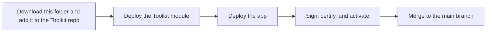

# Work Package Generator

An AI-assisted Cognite Fusion (Flows) app that builds Industrial Canvas work packages from work orders, plus the Toolkit resources it needs.

## Overview

Without this app, planners find a work order, hunt for related files and time series, open Industrial Canvas, and place resources by hand. The Work Package Generator replaces that with a guided five-step flow: search for a work order, pick a canvas template, review related resources, review the AI's slot assignments, then create or update a canvas.

> **Deploy the Toolkit resources first.** The app has no in-code defaults. It reads its configuration from one CDF config node (`inst_wpg_app_config` / `wpg_config`) created by this module. Without it, the app shows a setup screen instead of the workflow. See [Deployment](#deployment).

### Features

- **Five-step workflow** – Work Order → Template → Resources → Selections → Create, with a stepper and Back/Next navigation
- **Work order search** – Search by ID, name, or description; pick a row, then click “Use selected work order”
- **AI template recommendation** – After a work order and asset are loaded, AI suggests a template canvas
- **AI resource selection** – AI selects resources (for example files and time series) per template field
- **Canvas creation** – Create a new canvas or update an existing one from the selected template and resources
- **Per-project configuration** – All project-specific settings live on the config node. The same app bundle runs in every project.

### How to use

1. **Search** – Enter a work order ID, name, or description and click **Find**.
2. **Select** – Click a row in the results table, then **Use selected work order**.
3. **Template** – Pick a template (the AI recommendation is highlighted) or choose another.
4. **Resources** – Expand resource types to see files and time series linked to the asset.
5. **Selections** – Review the AI-selected resources per template field.
6. **Create** – Enter a canvas name, then **Create canvas**, or **Update existing** if a canvas with that name exists.

To switch work order mid-flow, go to the Work Order step, enter a new query, and click **Find**. The process resets.

Product goals and non-goals are in [PRD.md](PRD.md). User-visible behavior is specified in [SPEC.md](SPEC.md); update it when the workflow, CDF reads/writes, or AI agent behavior changes.

Before certifying or handing over the app, fill in [App-Brief.md](App-Brief.md) with your own details (customer, tier, owner, maintainer, support path, users, business value, milestones, user role, problem, and success criteria). Changing the maintainer alias after certification triggers re-certification.

## Module Components

### Toolkit resources

| Resource | Identifier | Purpose |
| --- | --- | --- |
| Schema space | `dm_sol_wpg_app` | Holds the config data model and view |
| Config instance space | `inst_wpg_app_config` | Holds the config node. Keep it out of scoped write grants. |
| Data model | `WPGConfig_SOL` | Version comes from `wpg_config_version` |
| Container and view | `WPGConfig` | Shape of the config node |
| Config node | space `inst_wpg_app_config`, external id `wpg_config` | The app's per-project configuration |
| AI agent | `{cdf_project}_{wpg_agent_external_id_suffix}` | Template recommendation and resource selection |

These names are literals in the YAML and in `src/app-config/config-location.ts`. Renaming them without a matching app release stops the app from finding the node. `src/app-config/toolkit-drift.test.ts` checks that they stay aligned.

The app lists data models in `dm_sol_wpg_app` with `allVersions=false` and uses the `WPGConfig` view version on the latest `WPGConfig_SOL`. A view version bump does not require an app rebuild. Bump `wpg_config_version` only when a top-level property is added or changed, and bump the view and data model together.

`schemaVersion` on the node is the content shape (currently `1`). Renaming or removing a key inside a section requires a `schemaVersion` bump and a matching app release. The view version does not protect against that.

### Flows app

A React 19 / TypeScript / Vite app built on `@cognite/app-sdk`, `@cognite/sdk`, and `@cognite/aura`. It includes a read-only Industrial Canvas preview (`src/canvas-preview/`) used by the Create step.

## Deployment

### Release flow

Run the Toolkit build and deploy commands from the **root of the repo**. Run every Cognite CLI app command (`apps deploy`, `apps sign`, `apps publish`, `apps activate`, `apps skills pull`, `apps status`, `apps submit`) from **this module folder**:

`modules/tools/apps/work_package_generator`

Those commands read `app.json` in the current directory. Running them from the library repo root fails because `app.json` is not there.



1. Download `work_package_generator` and add it to the Toolkit project (see [Adding the module to a Toolkit project](#adding-the-module-to-a-toolkit-project)).
2. Update `dataModel.views` in `data_modeling/wpg_config.Node.yaml` to your enterprise data model (DOM) before the Toolkit deploy.
3. From the root of the repo, build the module, dry-run the plan, then deploy (see [Build and deploy](#build-and-deploy)).
4. Deploy the app from this module folder.
5. Sign the bundle, certify it for production, publish, and activate (see [Sign, certify, and activate](#8-sign-certify-and-activate)).
6. Merge the module changes to the main branch of the repo that ships this app.

### Prerequisites

- Cognite Toolkit **0.9.x** or later
- `agents = true` under `[alpha_flags]` in the project's `cdf.toml` (the module deploys an AI agent)
- Node **22.12+** and npm, for the app
- Access to the npm registry that hosts `@cognite/aura` and `@cognite/app-sdk`
- A CDF project with Core Data Model activities, assets, files, and time series, and the Industrial Canvas data model (see [Data model, spaces, and permissions](#3-data-model-spaces-and-permissions))

### Adding the module to a Toolkit project

1. Add the module to your Toolkit project (for example with `cdf modules add` and select **Work Package Generator Application** from the *Tools and Accelerators* package). Its variables are merged into your `config.<env>.yaml` under `modules.<path>.work_package_generator`.
2. Set `cdf_project` to your CDF project name. The agent external id and the app both use it.
3. Review the other variables (see [Variables](#variables)).
4. Point `dataModel.views` in `data_modeling/wpg_config.Node.yaml` at your enterprise data model (DOM) before the Toolkit deploy. The shipped views are Cognite Core (`CogniteAsset`, `CogniteActivity`, and so on). See [Point a view at a different data model](#point-a-view-at-a-different-data-model).
5. [Build and deploy](#build-and-deploy) the Toolkit resources.
6. From `modules/tools/apps/work_package_generator`, deploy the app, then sign, certify, and activate it (see [Deploy the app](#7-deploy-the-app) and [Sign, certify, and activate](#8-sign-certify-and-activate)).

### Build and deploy

Before you deploy, update `dataModel.views` in `data_modeling/wpg_config.Node.yaml` to your enterprise data model (DOM). The file ships Cognite Core views (`cdf_cdm` / `CogniteAsset`, `CogniteEquipment`, `CogniteActivity`, `CogniteTimeSeries`, `CogniteFile`). Replace `space`, `externalId`, and `version` for each role your project does not serve from Core, and align `resourceTypes`, `context`, and `workOrderProperties` with that model's property names. `cdf deploy` writes this node as-is and overwrites later Fusion edits. See [Point a view at a different data model](#point-a-view-at-a-different-data-model).

From the root of the repo:

```bash
cdf build -c config.<env>.yaml -m work_package_generator
cdf deploy --dry-run --verbose
cdf deploy
```

`cdf build` builds only this module, using `config.dev.yaml`. `cdf deploy --dry-run --verbose` prints the deploy plan so you can check it before anything is written. `cdf deploy` writes the built resources to CDF.

`cdf deploy` overwrites the config node, including edits made in Fusion. This module is the source of truth. Change values here and redeploy. Two installs of this app in one project are not supported.

### Variables

`cdf build` substitutes these from your `config.<env>.yaml`. `default.config.yaml` lists the defaults.

- `cdf_project` – CDF project name, used in the agent external id
- `wpg_config_version` – view and data model version
- `wpg_cdm_view_version`, `wpg_canvas_view_version` (`Canvas`, default `v7`), `wpg_canvas_child_view_version` (`FdmInstanceContainerReference` and `CanvasAnnotation`, default `v1`), `wpg_solution_tag_view_version`
- `wpg_canvas_instance_space`, `wpg_solution_tag_instance_space`
- `wpg_agent_model`, `wpg_agent_runtime_version`, `wpg_agent_external_id_suffix`, `wpg_agent_name`, `wpg_agent_description` – also used by `agents/agent_work_package_generator.Agent.yaml`
- `wpg_limits_*` – page, batch, search, and scan caps
- `wpg_fusion_fallback_organization` – org slug used only when the app is not opened from a Fusion host. Leave empty when users open the app inside Fusion.

`prompts`, `ui`, `context`, and `resourceTypes` are literal JSON on the node. Edit `data_modeling/wpg_config.Node.yaml` to change them. Prompt text uses `{{placeholder}}` tokens that the app fills at runtime. In that JSON, write each opening pair as `\u007b\u007b` (for example `\u007b\u007bworkOrderSection}}`). YAML and JSON both decode that to `{{placeholder}}`, and `cdf build` does not treat it as a Toolkit variable. If **every** `wpg_*` variable is unresolved, your `config.<env>.yaml` is not loaded.

`wpg_agent_model` is `cognite/fast`. The Toolkit agent schema does not list that model, so `cdf build` reports a **ModelSyntaxWarning** for the agent file. This is expected. The built agent still uses `cognite/fast`, which is the model the app sends.

Agent `instructions` and `tools` are literal `""` and `[]` in both the agent file and the node. Change both if you add tools or instructions.

### Access

This module does not deploy groups. CDF has no deny. “Restricted” means `inst_wpg_app_config` is kept out of scoped write grants.

- **App users:** `dataModels:read` covering `dm_sol_wpg_app` and `dataModelInstances:read` covering `inst_wpg_app_config`. An unscoped read already covers both. Add these spaces only to groups whose read is limited to a list of spaces.
- **Config editors:** `dataModelInstances:write` covering `inst_wpg_app_config`. Anyone with unscoped `dataModelInstances:write` can still change the node. Scope write grants if that is not acceptable.
- **Deploy principal:** `dataModels:write` and `dataModelInstances:write` on these spaces (normal Toolkit deploy rights).

The full capability list for app users is in [3.5 Capabilities](#35-capabilities).

### Setting up a new CDF project

#### 1. Get the app code

1. Open a terminal in this module folder.
2. Install dependencies (Node 22.12+; CI uses Node 22):

   ```bash
   npm install
   ```

3. Optional: copy `env.example` to `.env` for local overrides (for example `PORT` / `DEV_PORT`). Vite dev server defaults are in `vite.config.ts`.
4. Make sure the Toolkit resources are deployed, then start the app locally:

   ```bash
   npm start
   ```

   The app opens in the browser (or in Fusion when running in the Flows host). On first run you may be prompted to install a locally-trusted SSL certificate for the HTTPS dev server. For a full production build and type check: `npm run build`.

#### 2. Point the app at your organization and CDF project

Deploy the Toolkit resources first. That creates the config node. Project and cluster come from the signed-in CDF session. The Fusion org comes from the host page. Set `wpg_fusion_fallback_organization` only when the app is opened outside Fusion.

##### 2.1 CLI deployment (`deployments[0]`)

`app.json` `deployments` is for the Cognite CLI only. The running app does not read it. The shipped values are placeholders (`ORG`, `PROJECT`, `BASE_URL`, `CLIENT_ID`, `SECRET_NAME`). Replace each one by hand for the target project before deploying. The CLI does not fill them in from `.env`.

| Field | Purpose |
|--------|--------|
| `org` | Fusion organization slug stored for the CLI deployment record |
| `project` | CDF project name you deploy the app to |
| `baseUrl` | CDF API base URL for that cluster, for example `https://az-eastus-1.cognitedata.com` |
| `deployClientId` | Service principal client ID for non-interactive deploy |
| `deploySecretName` | Name of the secret holding the client secret in your CI environment |

##### 2.2 App identity

- **`externalId`** – Unique application id in CDF/Fusion. Use a distinct value if you deploy multiple instances.
- **`name`**, **`description`**, **`versionTag`** – Shown in Fusion and tooling.

##### 2.3 AI agent

The app creates and uses an AI agent at runtime. The external id is `{project}_{agent.externalIdSuffix}` (shipped suffix: `work_package_generator_helper_agent`), unless `agent.existingAgentExternalId` is set on the config node. In that case the app uses that id and does not create an agent. Tools come from `agent.tools` (shipped `[]`). Instructions come from `agent.instructions` and may be an empty string. The agent YAML and the config node share the agent variables in your `config.<env>.yaml`.

#### 3. Data model, spaces, and permissions

The app expects **Cognite Data Modeling** instances your users can **read** (and **write** for canvas creation). The shipped config node targets standard Cognite Core Data Model and Industrial Canvas views. Change those keys on the node when the customer model differs. See [Config keys](#config-keys).

##### 3.1 Work orders (search and selection)

- **View:** `dataModel.views.activity` (shipped: `cdf_cdm` / `CogniteActivity` / `v1`).
- Work orders are **node** instances of that view. The UI searches by external id, name, or description and reads linked **assets** from the activity's `assets` relation.

Your project must have maintenance or work-order style activities on that view, or you must point `dataModel.views.activity` at the customer's view.

##### 3.2 Assets and equipment

- **Views:** `CogniteAsset` and `CogniteEquipment` in `cdf_cdm` (`v1`), used when resolving context and resources from the work order's linked assets.

##### 3.3 Files and time series (resource step)

- **Views:** `CogniteFile`, `CogniteTimeSeries` in `cdf_cdm` (`v1`).
- Resources are discovered via relations from the asset (and, for time series, from the activity where applicable), as implemented in `src/api/retrieve-data.ts`.

##### 3.4 Industrial Canvas (templates and output)

- **Canvas definition** lives under `canvas.schemaSpace` (shipped: `cdf_industrial_canvas`). The root, item, and annotation views are `canvas.canvasView`, `instanceView`, and `annotationView`.
- **New canvases** (your work packages) are created as nodes in `canvas.instanceSpace` (shipped: `IndustrialCanvasInstanceSpace`).

If your tenant uses different spaces or view versions, update those `canvas` and `dataModel` properties on the config node and redeploy. A JavaScript rebuild is not required.

##### 3.5 Capabilities

`src/api` calls DMS `instances.search`, `instances.query`, `instances.retrieve`, `instances.upsert`, and `instances.delete`, plus `dataModels.list` for the config view version and `profiles.me()`. `src/api/ai-agent.ts` calls `POST /ai/agents`, `POST /ai/agents/byids`, and `POST /ai/agents/chat`. Names below match [DMS access control](https://docs.cognite.com/cdf/dm/dm_concepts/dm_access_control) and [Agents capabilities](https://docs.cognite.com/cdf/access/guides/capabilities). Shipped runtime is `1.2.0`, so `sessions:create` (required for agent runtime 2.0+) is not listed.

| Capability | Actions | Scope for the shipped config | Used for |
| --- | --- | --- | --- |
| `dataModels` | `READ` | spaces `cdf_cdm`, `cdf_industrial_canvas`, `cdf_apps_shared`, `dm_sol_wpg_app` | Schema of the views referenced by instance calls, and the WPG config data model |
| `dataModelInstances` | `READ` | spaces that hold activities, assets, files, time series, and template canvases, plus `inst_wpg_app_config` | Search, query, retrieve, and the config node |
| `dataModelInstances` | `WRITE` | `inst_wpg_app_config` | Config editors only. Keep this space out of other scoped write grants. |
| `dataModelInstances` | `READ`, `WRITE` | `IndustrialCanvasInstanceSpace`, `SolutionTagsInstanceSpace` | Canvas create/update/delete and solution-tag upsert |
| `agents` | `READ`, `WRITE`, `RUN` | `all` if the app must create `{project}_{suffix}`; otherwise that agent's external id plus `WRITE` on `all` only when creation is required (scoped write cannot create) | List/retrieve, create, chat |
| `userProfiles` | `READ` | (confirm) usually granted to any group member | `profiles.me()` for the canvas owner |

The deploy service principal needs whatever the Cognite CLI deploy path requires. Confirm that set separately; this table is the signed-in app user.

#### 4. AI agents

Template recommendation and per-field resource selection call the CDF AI Agents HTTP API (see `src/api/ai-agent.ts`):

1. **`getOrCreateAgent`** – Looks up the agent by external id. If `agent.existingAgentExternalId` is set, that id is used and a missing agent is an error. Otherwise, if `{project}_{agent.externalIdSuffix}` is missing, it creates an agent with the model, runtime, name, description, instructions, and tools from `agent`.
2. **`queryAiForSelection`** / canvas recommendation – POST to the agent chat endpoint.

Requirements:

- The signed-in user (or app identity) must be allowed to use **AI agents** in the project.
- If agent creation is blocked by policy, create an agent with external id `{your_project}_{agent.externalIdSuffix}` manually and grant access. Change `agent.model` when the customer should use a different model.

If AI is unavailable, fix capability errors in Fusion/CDF IAM if calls fail with 403/401.

#### 5. Creating canvas templates the app will list

The app discovers templates by listing **canvas** instances (Industrial Canvas roots) whose `name` property starts with `templates.namePrefix` (case-insensitive; shipped prefix: `template`).

1. In **Fusion → Industrial Canvas**, create a canvas document.
2. Set the canvas **name** so it starts with `template`, for example `template — Maintenance overview` or `template_work_package_v1`.
3. Add **FDM instance** placeholders on the canvas for:
   - The **main** work order and asset representations (the app detects “main” slots by label heuristics in `useTemplateFields` / `getTemplateCanvasInstances`).
   - Additional slots whose **labels** correspond to resource types in `resourceTypes`. A slot is selectable when its view external id matches the view that resource type points at (shipped file and time series types use `CogniteFile` and `CogniteTimeSeries`).
4. Save/publish so the canvas exists as DMS instances your users can read.

To change the naming rule, set `templates.namePrefix` on the config node and redeploy. A JavaScript rebuild is not required.

#### 6. Finding work packages (generated canvases) in CDF

A **work package** is a **created Industrial Canvas** instance, not a separate type.

After creation, the app builds a Fusion URL with `generateCanvasLink` (`src/api/canvas-builder.ts`):

`https://<org>.fusion.cognite.com/<project>/industrial-canvas/canvas?canvasId=<uuid>&cluster=<cluster>.cognitedata.com&workspace=industrial-tools`

In Data modeling / APIs:

- **Space:** `canvas.instanceSpace` (shipped: `IndustrialCanvasInstanceSpace`)
- **Root node:** `externalId` is a UUID returned as `canvasId` from create; the canvas `name` is the name entered in the final step
- Query instances on `canvas.canvasView` and filter by `name` or `externalId` as needed

#### 7. Deploy the app

##### 7.1 Interactive (local)

From this module folder:

```bash
npm run deploy
```

This runs the Cognite CLI in interactive mode. Useful flags:

- `-d 0` – Use the first deployment target
- `-d <project-name>` – Use a specific project
- `--skip-build` – Deploy without rebuilding

##### 7.2 Non-interactive

From this module folder (`modules/tools/apps/work_package_generator`), not the library repo root:

- Set `deployClientId` and `deploySecretName` in `app.json` to match your pipeline secrets.
- Provide the client secret in the environment under the name referenced by `deploySecretName`.
- Run the Cognite CLI without `--interactive` (there is no `deploy:ci` npm script):

  ```bash
  npx @cognite/cli@latest apps deploy
  ```

##### 7.3 Private npm packages

The committed `.npmrc` sets `legacy-peer-deps=true`, which `npm install` needs for this dependency set. If your registry requires authentication, add the token to your user-level `~/.npmrc` or pass `NODE_AUTH_TOKEN` in automated environments. Never commit a token.

#### 8. Sign, certify, and activate

Deploying the Toolkit module and uploading the app leaves the version as a draft. Publishing to a CDF project needs a developer signature. A production project also needs Cognite's application certification signature. Follow [Signing Flows custom apps from the CLI](https://docs.cognite.com/cdf/flows/guides/code-signing) and [Certifying a Flows custom app for production](https://docs.cognite.com/cdf/flows/guides/application-certification).

Run every command in this section from `modules/tools/apps/work_package_generator`. You need a registered signing key (`npx @cognite/cli@latest keys generate --interactive`, then submit the Zendesk form the CLI prints) and [builder certification](https://docs.cognite.com/cdf/flows/guides/builder-certification.md). Projects with [Dev status](https://docs.cognite.com/cdf/flows/guides/dev-status.md) need only the developer signature. Production projects need both signatures.

##### 8.1 Pull builder skills

Certification is skill-driven. Pull the skills into this app before you run them. See [About builder skills](https://docs.cognite.com/cdf/flows/concepts/skills).

```bash
npx @cognite/cli@latest apps skills pull
```

The CLI writes skills under `.agents/skills/` and `.claude/skills/`. In Cursor or Claude Code, run these slash commands in order:

| Skill | What it produces |
| --- | --- |
| `/flows-app-brief` | `App-Brief.md` at the module root. Required fields must be filled in. |
| `/flows-code-review` | `reviews/code-review/feedback-round-N/`. Re-run until `Must Fix open: 0`. |
| `/flows-design-review` | `reviews/design-review/feedback-round-N/`. Target average **3.8** or higher. |
| `/flows-external-app-submit` | Checks the gates above, then runs `apps submit`. |

Commit `App-Brief.md` and the latest review reports before submit. The source archive includes only committed files, and `apps submit` fails when the working tree is dirty.

##### 8.2 Sign

`apps deploy` (section 7) uploads a draft and keeps the exact bytes at `.cognite-bundles/<externalId>-<versionTag>.zip`. Do not commit that folder.

```bash
npx @cognite/cli@latest apps sign
npx @cognite/cli@latest apps status .
```

`apps sign` writes `<bundle>.dev.sig` beside the zip and submits the developer signature. `apps status` should list that signature. A verdict other than `VALID` blocks serve-time verification; the [verdict table](https://docs.cognite.com/cdf/flows/guides/code-signing#upload-sign-and-publish-the-app) says what to do.

##### 8.3 Certify for production

Skip this step for a Dev status project and go to [8.4 Publish and activate](#84-publish-and-activate).

After `apps deploy` and `apps sign`, and with a clean git tree:

```bash
npx @cognite/cli@latest apps submit
```

`/flows-external-app-submit` runs this after the gates pass. Attach everything the CLI places in the submit folder, plus a short screen recording of the primary tasks, to the pre-filled Zendesk ticket.

When Cognite approves the version, save the returned `.cert.sig` next to the developer signature:

```text
.cognite-bundles/
  <externalId>-<versionTag>.zip
  <externalId>-<versionTag>.zip.dev.sig
  <externalId>-<versionTag>.zip.cert.sig
```

Do not commit `.cert.sig`. Any later code change needs a new version and a new certification before it can be published to production.

##### 8.4 Publish and activate

```bash
npx @cognite/cli@latest apps publish .
npx @cognite/cli@latest apps activate
npx @cognite/cli@latest apps status .
```

`apps publish` moves the version from DRAFT to PUBLISHED and submits `.dev.sig` (and `.cert.sig` when it is present). `apps activate` makes that published version the one Fusion serves. `apps status` should show **PUBLISHED** and each signature as **VALID**.

If the bundle changes after signing (a new `npm run build`, an edit under `dist/`, or a version bump), run `apps deploy`, `apps sign`, and `apps publish` again, and recertify before a production publish.

#### 9. Quick verification checklist

- [ ] Toolkit resources are deployed, and app users can read `dm_sol_wpg_app` and `inst_wpg_app_config`.
- [ ] `app.json` `project` and `baseUrl` match the CLI deploy target. Fusion org comes from the host page.
- [ ] CDM activities exist and are searchable as work orders.
- [ ] Linked assets have related files/time series if you expect the Resources step to be useful.
- [ ] Industrial Canvas model is present; at least one canvas named with the `template` prefix appears in the Template step.
- [ ] User can create instances in `IndustrialCanvasInstanceSpace`.
- [ ] Config node is complete for this customer (views, canvas spaces, agent model and suffix).
- [ ] AI agent API works or you created `{project}_{agent.externalIdSuffix}` manually.
- [ ] After create, Fusion opens the canvas using the host org (or `fusion.fallbackOrganization`) and the returned `canvasId`.
- [ ] `apps status` shows the version as **PUBLISHED**, the developer signature as **VALID**, and (on a production project) the certification signature as **VALID**. The version is activated.

### Config keys

Edit the config node (`data_modeling/wpg_config.Node.yaml`, with values from your `config.<env>.yaml`) and redeploy. A JavaScript rebuild is not required. Keys below are the node properties. You can add extra entries under `dataModel.views` and `resourceTypes`. A resource type `view` value must be a key in `dataModel.views`. `limits.instancePageSize`, `upsertBatchSize`, and `deleteBatchSize` must be integers from 1 to 1000. `schemaVersion` must be `1`.

#### Point a view at a different data model

Each entry under `dataModel.views` in `data_modeling/wpg_config.Node.yaml` is the view the app reads for that role. `space`, `externalId`, and `version` are the CDF view identity. The shipped `externalId` values (`CogniteAsset`, `CogniteEquipment`, `CogniteActivity`, and so on) are literals in that file. Only the version is a Toolkit variable (`wpg_cdm_view_version` in `config.<env>.yaml` or `default.config.yaml`).

To pull assets from a customer view instead of `CogniteAsset`, change the `asset` entry. For example, a `WorkOrder` view in space `sp_customer`:

```yaml
asset:
  space: sp_customer
  externalId: WorkOrder
  version: "v1"
```

Then update anything that assumes Cognite Core property names on that role:

- `resourceTypes` entries whose `view` is `asset` — `properties`, `assetRelationProperty`, and `assetRelationIsArray` must match the new view.
- `context.asset.properties` — property names sent to the agent.
- `workOrderProperties` — only when you change `dataModel.views.activity` (the work-order search view). Property names there must exist on the new activity view.
- `dataModel.activityContainer` — only when the activity container is not `cdf_cdm` / `CogniteActivity`.

Leave the key (`asset`, `activity`, …) as it is. The app looks up roles by that key. `cdf deploy` overwrites the live node, so edit the YAML and redeploy rather than editing the node in Fusion.

| Key | Change per customer? | Shipped value / role |
| --- | --- | --- |
| `dataModel.views.asset` | If the model differs | `cdf_cdm` / `CogniteAsset` / `v1` |
| `dataModel.views.equipment` | If the model differs | `cdf_cdm` / `CogniteEquipment` / `v1` |
| `dataModel.views.activity` | If the model differs | `cdf_cdm` / `CogniteActivity` / `v1` (work orders) |
| `dataModel.views.timeSeries` | If the model differs | `cdf_cdm` / `CogniteTimeSeries` / `v1` |
| `dataModel.views.file` | If the model differs | `cdf_cdm` / `CogniteFile` / `v1` |
| `dataModel.views.solutionTag` | If the model differs | `cdf_apps_shared` / `CogniteSolutionTag` / `v1` |
| `dataModel.activityContainer` | If the model differs | Container used to traverse from an activity (`cdf_cdm` / `CogniteActivity`) |
| `canvas.schemaSpace` | If the model differs | `cdf_industrial_canvas` |
| `canvas.instanceSpace` | If the space differs | `IndustrialCanvasInstanceSpace` |
| `canvas.canvasView` | If the model differs | `Canvas` / `v7` |
| `canvas.instanceView` | If the model differs | `FdmInstanceContainerReference` / `v1` |
| `canvas.annotationView` | If the model differs | `CanvasAnnotation` / `v1` |
| `canvas.dimensions` | Rarely | Default item box: x 0, y 0, width 600, height 400, max 1200 |
| `canvas.userId` | Rarely | Canvas owner fallback: `work-package-generator` |
| `canvas.visibility` | Rarely | `"public"` or `"private"` on the canvas root |
| `canvas.style` | Rarely | Sticky header colors and border on the base template |
| `resourceTypes.*` | If relations differ | `activity`, `asset`, `equipment`, `file`, `timeseries`. Each has `displayName`, `view` (a view key), `properties`, `assetRelationProperty`, `assetRelationIsArray`. Time series also has `activityContainerIdentifier`. |
| `context.workOrder.properties` | If prompts should use other fields | Property names sent to the agent for the work order |
| `context.asset.properties` | If prompts should use other fields | Property names sent to the agent for the asset |
| `agent.model` | Yes | `cognite/fast` |
| `agent.runtimeVersion` | If the agent runtime differs | `1.2.0` |
| `agent.externalIdSuffix` | Yes, if the agent id should differ | Runtime id is `{project}_{suffix}` |
| `agent.name`, `.description`, `.instructions` | Yes | Create-agent payload. Instructions may be `""`. |
| `agent.existingAgentExternalId` | Optional | When set, use this agent and do not create one. |
| `agent.tools` | Rarely | Tools on the create payload. Shipped `[]`. |
| `fusion.hostSuffix` | If the Fusion host differs | Shipped `.fusion.cognite.com`. Includes the leading dot. |
| `fusion.canvasWorkspace` | If the canvas workspace differs | Shipped `industrial-tools`. |
| `fusion.fallbackOrganization` | When the app is not opened from Fusion | Optional org slug. Leave empty inside Fusion. |
| `workOrderProperties` | If activity property names differ | Maps CDF property names onto the work order fields the app reads, filters, and sorts. |
| `prompts.resourceSelection`, `.templateSelection` | If the agent wording should change | Prompt text with `{{placeholder}}` tokens. Missing tokens fail at startup. |
| `ui` | If labels or filter options differ | Status and priority options, instruction examples, terms (`workOrder`, `workPackage`, `functionalLocation`), and the five stepper labels. |
| `templates.namePrefix` | If template names use another prefix | `template` |
| `templates.baseTemplate` | Rarely | Built-in “All Resources” template. `id` `__base_all_resources__` is synthetic and is not stored in CDF. |
| `solutionTag` | If the tag should differ | Instance `SolutionTagsInstanceSpace` / `wpg-work-package` / `Work Package` |
| `limits.*` | Rarely | Page, batch, search, and scan caps. The three DMS batch sizes must stay within 1000. |
| `cluster.apiHostSuffix` | If the API host is not Cognite's | `cognitedata.com` |
| `cluster.hostAliases` | Rarely | Host that is not `{clusterId}.cognitedata.com`. Shipped map sends `api.cognitedata.com` to cluster id `api`. Leave it unless the API host does not follow that pattern. |

## Module Structure

```
work_package_generator/
├── module.toml                 # Toolkit module definition
├── default.config.yaml         # Default Toolkit variables
├── agents/                     # AI agent
├── data_modeling/              # Spaces, WPGConfig container/view/data model, config node
├── app.json                    # App identity and CLI deployment target
├── manifest.json               # Host CSP network permissions
├── PRD.md                      # Product goals, non-goals, workflow
├── SPEC.md                     # User-visible behavior (source of truth)
├── App-Brief.md                # Certification brief
├── src/
│   ├── api/                    # CDF, AI agent, and canvas API
│   ├── app-config/             # Loads and validates the CDF config node
│   ├── canvas-preview/         # Vendored read-only Industrial Canvas preview
│   ├── components/             # Layout, UI primitives, work-package components
│   ├── contexts/               # Navigation context
│   ├── hooks/                  # Search, select, templates, AI, create
│   ├── pages/
│   ├── utils/                  # CDF helpers, formatting
│   ├── store.ts                # Zustand store
│   └── types.ts
├── scripts/                    # ESLint TypeScript preload
└── package.json
```

### Key technologies

- **React 19**, **TypeScript**, **Vite**, **Tailwind CSS v4**
- **Zustand** (global state) and **TanStack React Query** (data fetching)
- **@cognite/sdk** (CDF client), **@cognite/app-sdk** (Flows hosting and Fusion auth), **@cognite/aura** (design system). Aura's stylesheet loads Inter, Space Grotesk, and Source Code Pro from Google Fonts, so `manifest.json` keeps those network permissions. Tables are local markup because Aura 1.47 has no Table export. Theme tokens are compiled at build time.
- **Canvas preview** – Industrial Canvas rendering under `src/canvas-preview/`. Those files are vendored and read-only; see `src/canvas-preview/README.md`.
- **Vitest** (tests), **Biome** (lint, format, import order), **ESLint** (Aura design-system rules only). ESLint runs through `scripts/eslint-ts6-preload.cjs` because `typescript-eslint` does not support TypeScript 7 yet.

### Scripts

| Command | Description |
|--------|-------------|
| `npm start` | Start dev server (HTTPS) |
| `npm run build` | TypeScript check and production build |
| `npm run preview` | Serve production build locally |
| `npm test` | Run tests |
| `npm run test:watch` | Tests in watch mode |
| `npm run lint` | Lint with Biome |
| `npm run lint:aura` | Check Aura design-system rules with ESLint |
| `npm run lint:fix` | Fix lint issues |
| `npm run format` / `npm run format:check` | Format with Biome / check formatting |
| `npm run type-check` | TypeScript check only |
| `npm run deploy` | Build and deploy |

### Development conventions

- Business logic lives in `use<Name>ViewModel` hooks. Components only render.
- Inject dependencies through React context (hooks, components) or factory overrides (plain functions) rather than hard-coding them.
- Write tests first. Every new module with logic gets a `*.test.ts(x)` file in the same change. Prefer dependency injection over `vi.mock`.
- Never use `any` or `as unknown as T`.

## Support

### Known limitations

- **Private-link orgs.** `fusionOrganizationFromHostname` only matches `fusion.hostSuffix` (shipped `.fusion.cognite.com`). A private-link or custom Fusion host does not yield an org unless that suffix is changed; the app then uses `fusion.fallbackOrganization` when it is set.
- **Theming.** Aura tokens are compiled into CSS at build time. Per-customer colors need a rebuild.
- **Fonts.** `@cognite/aura` imports its fonts from `fonts.googleapis.com`. The app does not ship the font files.

### Troubleshooting

- **SSL on first run** – Accept the certificate prompt for local HTTPS.
- **Port in use** – Set `PORT=3002` (or another port) in the environment or `.env`.
- **Build fails** – Run `npm run type-check` and fix TypeScript errors; if needed, delete `node_modules` and `package-lock.json` and run `npm install` again.
- **Setup screen on start** – The config node is missing or invalid. Deploy this module's Toolkit resources to the project and check the listed problems.
- **Auth** – Ensure you are logged into the correct CDF project and that the deployment target in `app.json` matches.

### Resources

- [Cognite Data Fusion docs](https://docs.cognite.com)
- [Cognite SDK (TypeScript)](https://docs.cognite.com/sdks/typescript/)
- [Cognite App SDK](https://www.npmjs.com/package/@cognite/app-sdk)
- [Cognite Toolkit](https://docs.cognite.com/cdf/deploy/cdf_toolkit/)
- [Signing Flows custom apps from the CLI](https://docs.cognite.com/cdf/flows/guides/code-signing)
- [About builder skills](https://docs.cognite.com/cdf/flows/concepts/skills)
- [Certifying a Flows custom app for production](https://docs.cognite.com/cdf/flows/guides/application-certification)
